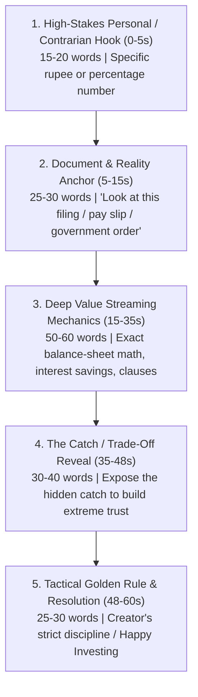

# FinanceWizardCL Instagram Reels Intelligence & Framework

> **Knowledge Base:** Forensic extraction of **197 live Instagram Reels** directly from [`@financewizardcl`](https://www.instagram.com/financewizardcl) (Chandralekha Mittemari Ravikumar, 1.1M followers, ex-KPMG, CMA, CIA, founder of *Dime*).  
> **Audience Scale:** **Over 86.8% of her reels cross 100k+ views**, 15.7% cross **1 Million+ views**, and top mega-viral reels command **14.6M to 56.9 Million views**!  
> **Target Video Duration:** **55 – 60 seconds** (Sweet spot: ~57 seconds).  
> **Target Word Count:** **150 – 175 words** at a natural **160 – 180 WPM** delivery.  
> **Core Channel Ethos:** High-retention *"Value Streaming"* (Zero Fluff, Real Mathematical Proof) combined with SaN's *"Happy Investing"* discipline.

---

## 1. Instagram Viral Performance Tiers (197 Reels Analyzed)

From our direct headless browser audit of 197 reels on `instagram.com/financewizardcl/reels/`:

| View Tier | Threshold | Reel Count | % of Profile | Real Top Examples |
| :--- | :--- | :--- | :--- | :--- |
| **Mega-Viral Tier** | **> 5 Million Views** | **6 Reels** | 3.0% | `DYG6raEpuM2` (**56.9M views** - Food delivery price hack); `DYCbE_uJ-mp` (**43.3M views** - Reading SEBI circulars/PDFs); `DP1aRpLCdSK` (**14.6M views** - Gold ₹1.22L jump & household gold math); `DOLl4u8CZ4Q` (**8.8M views** - 80-page Govt GST report breakdown); `DY7RPo5JnKc` (**6.3M views** - Census 2027 data collection). |
| **Viral Tier** | **1M – 5M Views** | **25 Reels** | 12.7% | `DTAktwUiU3j` (**5.2M views**); `DOqdkO0iSo8` (**4.5M views** - Senior Citizen 80TTB ₹7L tax-free math); `DSfSEBYiRg3` (**2.9M views** - SBI MaxGain Home Loan OD ₹15L interest saver); `DFiOII3T5WA` (**3.5M views** - New Budget Tax Rules). |
| **Strong Tier** | **500k – 1M Views** | **32 Reels** | 16.2% | Uber/Ola pricing traps, T-Bills RBI direct lending, PAN card misuse. |
| **Solid Bread-and-Butter** | **100k – 500k Views** | **108 Reels** | 54.8% | Credit card lounge rules, PF vs EPF deductions, term insurance exclusions. |
| **Below 100k** | **< 100k Views** | **26 Reels** | 13.2% | Routine sponsored collaborations with weak educational hooks. |

---

## 2. Forensic Anatomy: The 5-Part Instagram Retention Engine

Analysis of her top 30 viral Instagram reels (>1M views) demonstrates an unbreakable 5-part script anatomy:

### Part 1: High-Stakes Personal / Contrarian Hook (0 to 5s | 15–20 words)
- **Rule:** Never open with polite greetings or channel branding. Open with a contrarian decision, personal confession, or specific shocking number.
- **Top Instagram Case Studies:**
  - *"My grandfather built this house and saved ₹15 lakh using one bank trick."* (`DSfSEBYiRg3` — 2.9M views)
  - *"✨ This Dhanteras, gold is touching ₹1,22,000, a 58% jump in just one year... but only 3 countries hold 35% of the world's gold."* (`DP1aRpLCdSK` — 14.6M views)
  - *"If your parents are above 60 years old, this card is not just a discount pass, it's a life upgrade."* (`DOqdkO0iSo8` — 4.5M views)
  - *"Jio’s ₹30,000 Crore IPO is opening, but I am NOT applying for even a single share! Let me show you why."* (SaN Jio IPO formula)

### Part 2: Document & Reality Anchor (5 to 15s | 25–30 words)
- **Rule:** Pivot immediately into an official proof anchor. Point directly at the document, pay slip, or regulatory filing.
- **Visuals:** PDF report, Red Herring Prospectus (RHP), or bank statement on screen with marker highlights.
- **Why It Works:** Retail audiences are cynical about generic creator opinions. Audited proof instantly commands attention.

### Part 3: Deep Value Mechanics (15 to 35s | 50–60 words)
- **Rule:** Explain the *real mechanical arithmetic* that standard creators skip because they assume it's too complex.
- **Case Study (Home Loan OD, 2.9M views):**
  - She doesn't just say "save on interest". She calculates: *"On an ₹80 lakh loan, depositing ₹10 lakh drops effective principal to ₹70 lakh. Interest is calculated daily, dropping total interest from ₹86 lakh to ₹71 lakh."*
- **Application to Jio IPO:**
  - Explain Fresh Issue vs OFS: 0% OFS means promoters and tech giants (Meta, Google) aren't cashing out. All ₹30,000 Cr retires debt, saving ₹8,600 Cr in annual interest!

### Part 4: The Catch / Trade-Off Reveal (35 to 48s | 30–40 words)
- **Rule:** Always state the trade-off. This separates genuine educators from promoters and builds untouchable creator credibility.
- **Case Study (Home Loan OD, 2.9M views):**
  - *"What you should know: The interest rate on OD is usually 0.5% to 1% higher."*
- **Application to Jio IPO:**
  - *"So why am I skipping it? Because at a ₹10 Lakh Crore valuation, mega-caps do not double overnight. And every IPO is a gamble with two unknown variables: allotment luck and listing-day sentiment."*

### Part 5: Tactical Golden Rule & Close (48 to 60s | 25–30 words)
- **Rule:** Give the viewer a principled rule to live by.
- **SaN's Framework:**
  - *"No 200 DMA chart = No entry. I am completely okay to miss an early listing gain, but I refuse to let greed break my discipline. Happy Investing!"*

---

## 3. Spoken Teleprompter Invariants

1. **Clean Script Only:** Deliver 100% clean spoken words with zero brackets, timestamps, or camera cues in the teleprompter block.
2. **Word Count:** 150 – 175 words max (~55–60s) for single-topic reels; up to 300 words for deep multi-stage deconstructions.
3. **Pacing:** 160 – 180 words per minute.
4. **Tone:** Crisp, grounded, objective, zero panic, zero greed.

---

## 4. End-to-End Production Benchmark: Jio Mega IPO Reel (`Jio_Mega_IPO_Reel_Final_Master.mp4`)

This production exemplifies the complete `@financewizardcl` 5-part architecture brought to life in Remotion:

1. **Part 1: Contrarian Hook (Frames 0–184 | 0–6.1s):**
   - Spoken: *"Reliance Jio's ₹30,000 Crore IPO is officially opening. But is this an opportunity... or a trap?"*
   - Visual: Massive ₹30,213 Cr glowing cyan pill badge + heavy crimson "AVOID" stamp with bass thud.
2. **Part 2: Document Anchor (Frames 360–532 | 12.0–17.7s):**
   - Spoken: *"Look at the official 400-page DRHP..."*
   - Visual: 2.5D perspective document tilted in 3D space with fluorescent yellow highlighter sweep across Page 68 debt prepayment clause.
3. **Part 3: Deep Value Mechanics (Frames 532–1709 | 17.7–56.9s):**
   - Spoken: *"0% OFS... ₹70,000 Cr debt retired... saving ₹8,600 Cr every single year... 50% EBITDA margin..."*
   - Visual: Titanium padlock slam on Meta/Google/Ambani shares + debt shredder odometer + 50.1% EBITDA speedometer.
4. **Part 4: The Catch / Trade-Off (Frames 2053–2395 | 68.4–79.8s):**
   - Spoken: *"At ₹10 Lakh Crore valuation, mega-caps do not double overnight..."*
   - Visual: 34x PE vs 50x PE duel podium + IPO two-variable lottery risk cards.
5. **Part 5: Tactical Golden Rule & High-Conversion Outro (Frames 2395–3785 | 79.8–126.2s):**
   - Spoken: *"My rule is simple: No 200 DMA chart = No entry... drop you the link... Happy Investing!"*
   - Visual: Standalone Zomato/Swiggy/Paytm logos (-65%, -50%, -71%) + YouTube search bar typing animation (`"Happy Investing with SaN"`) + simulated `"JIO"` comment box + Link in Bio pill badge + official 2026 channel logo.
- **Key Takeaway:** Delivering deep balance-sheet truth and principled investing discipline converts cynical viewers into high-intent channel followers.
