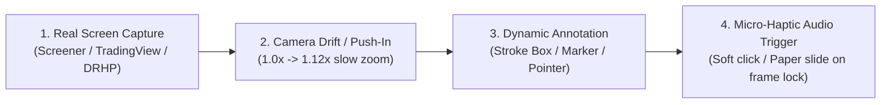

# Long-Form Finance Video Motion Graphics & Annotation Engine

> **Knowledge Base:** Reverse-engineered from top educational finance creators (**Sahil Bhadviya**, **Magnates Media**, **Finnovation**, **Vox Business**).  
> **Core Mandate:** **Never replace real screens with fake graphics.** The base layer must always be an **authentic real-world screen recording or document capture** (Screener.in, TradingView, audited DRHP filings). Remotion's sole function is to apply **kinetic annotations, camera movement, and chapter transitions ON TOP of the real screen**.

---

## 1. The 4 Dynamic Annotation Primitives

Static graphics kill retention. In high-trust financial YouTube videos, annotations must animate onto the screen with physical easing:



### Primitive A: The Stroke-Expansion Highlight Box
- **When to Use:** Highlighting a specific financial metric (e.g., P/E ratio, Market Cap, or EBITDA margin) on a real Screener.in or financial table.
- **Visual Design:**
  - Border: `3px solid #EF4444` (Signal Red) or `#FACC15` (Fluorescent Yellow) or `#00E599` (Mint Green).
  - Corner Radius: `8px`.
  - Background Tint: `rgba(239, 68, 68, 0.12)` or `rgba(250, 204, 21, 0.12)`.
- **Motion Physics (Remotion / CSS):**
  - Uses SVG `stroke-dasharray` and `stroke-dashoffset`.
  - Draw Duration: **250ms (7 to 8 frames at 30fps)**.
  - Easing: `spring({ damping: 14, stiffness: 120 })` or `ease-out`.
  - The box expands from the top-left corner, sweeps clockwise, and seals.
- **Audio Synchronization:** A crisp **soft UI click / dry keyboard tap** fires on the exact frame the box finishes drawing (`frame = 8`).

### Primitive B: The Realistic Marker Highlighter Sweep
- **When to Use:** Emphasizing a statutory sentence or clause in an official PDF filing (DRHP / SEBI circular / Annual Report).
- **Visual Design:**
  - Color: Fluorescent Yellow (`#FFE600`) or Mint (`#00E599`).
  - Blend Mode: `mix-blend-mode: multiply` with opacity `0.45` to `0.60`.
  - Height: Matches the exact line height of the scanned text with a subtle organic brush edge.
- **Motion Physics:**
  - Animate width: `interpolate(frame, [0, 15], [0, targetWidth], { extrapolateRight: 'clamp' })`.
  - Duration: **500ms (15 frames at 30fps)**.
- **Audio Synchronization:** A **paper friction / soft marker draw swoosh** starting at frame 0 and decaying at frame 15.

### Primitive C: The Dynamic Chart Breakout Pointer
- **When to Use:** Pointing out a moving average breakout (e.g. 200 DMA), an all-time high, or a crash bottom on a real TradingView candlestick chart.
- **Visual Design:**
  - Focal Node: Glowing circle (`r = 8px`, border `2px solid #FFF`) centered on the target candlestick.
  - Callout Arrow / Line: Smooth curved Bezier path extending to an annotation pill badge.
  - Annotation Badge: Dark matte pill (`background: rgba(17, 24, 39, 0.9)`) displaying the price and event (e.g., `★ 200 DMA Breakout: ₹65`).
- **Motion Physics:**
  - The focal circle pulses (`scale: 1.0` $\to$ `scale: 1.25` $\to$ `scale: 1.0` loop).
  - The line draws in **300ms**, and the badge pops with a subtle spring bounce (`scale: 0.8` $\to$ `1.0`).

### Primitive D: The Continuous Camera Drift (Digital Push-In)
- **Rule:** Never allow a real website capture to sit completely static for more than 3 seconds.
- **Motion Formula:**
  ```tsx
  const scale = interpolate(frame, [0, 300], [1.0, 1.12], {
    easing: Easing.bezier(0.25, 0.1, 0.25, 1.0),
    extrapolateRight: 'clamp',
  });
  const originX = activeRowPercentX; // e.g. '65%'
  const originY = activeRowPercentY; // e.g. '40%'
  ```
- **Effect:** The audience’s eyes are guided subconsciously toward the active number being discussed.

---

## 2. The Chapter Slide Wipe Engine (500ms Kinetic Transition)

Between chapters (Takes 1 through 6), use the signature **Sahil-Style Slide Wipe**:

- **Visual Architecture:**
  - Solid accent banner: Vibrant Red (`#E8292E`) or Orange (`#F97316`) or Brand Navy (`#1E3A8A`).
  - Direction: Wipes across the screen horizontally from **Left to Right**.
  - Total Duration: **500ms (15 frames at 30fps)**.
  - Keyframe Phasing:
    - **Frames 0–7:** Enters from left edge, fully covers screen at Frame 7.
    - **Frames 7–9:** Full-screen lock displaying `CHAPTER [X]: [TITLE]` in bold white sans-serif (Inter 800, 48px).
    - **Frames 9–15:** Clears to the right edge, revealing the next scene already active underneath.
- **Audio Pairing:** A fast **Air Whoosh / Whip Swoosh SFX** peaking at Frame 7 (-12dB).

---

## 3. Real Screen Capture & Preparation Standards

When capturing B-roll screens for the timeline:

1. **Browser Framing:**
   - Always record or capture the **real Google Chrome browser window** with the authentic URL bar and favicon. This proves you are on the actual live site.
   - Clean up bookmarks bar and close extraneous tabs before capturing.
2. **Resolution Standard:**
   - 1080p (1920×1080) or 4K (3840×2160) at 60fps or high-bitrate 30fps.
   - Never downscale or blur text. Financial data must be razor-sharp.
3. **TradingView Standards:**
   - Dark theme enabled (`#131722` background).
   - Turn off unnecessary gridlines if cluttered, but keep the **Price Scale (Right)** and **Date Axis (Bottom)** visible.
   - Indicator line (e.g. 200 SMA) should have thickness 2 or 3 in distinct purple or yellow.
4. **Screener.in Standards:**
   - Capture the full company header with market cap, P/E, and ROCE visible.
   - When discussing peers, scroll so the peer comparison table fills the upper two-thirds of the screen.

---

## 4. CapCut 3-Layer Timeline Integration Architecture

When assembling in CapCut:

```text
Track 1 (V1 - Base)    : SaN Facecam Video (Normalized, Eye-Level, Centered)
Track 2 (V2 - B-Roll)  : Real Screen Recordings (Screener.in / TradingView / PDF Filing)
Track 3 (V3 - Remotion): Transparent Motion Overlays (Highlight Boxes, Pointers, Wipes)
----------------------------------------------------------------------------------------
Track 4 (A1 - Dialogue): Master Enhanced Dialogue (+3dB, Voice Isolation ON)
Track 5 (A2 - SFX)     : Micro-Haptics (Whooshes at wipes, Soft Clicks at highlights)
Track 6 (A3 - BGM)     : Ambient Investing Bed (-26dB ducked under dialogue)
```

---

## 5. Clean Canvas & Anti-Clutter Mandate (No Corner Dockets)

- **Zero Arbitrary Corner Text:** Never render mock case dockets (e.g. FILE: EQUITAS-BNK-2026), classification banners (SPECIAL FORENSIC REPORT), technical axis indicators (AXIS: 1920x1080 // 30 FPS), or artificial corner watermarks.
- **Clean Margins:** Canvas edges and borders must remain 100% clean, professional, and distraction-free.
- Branding, channel watermarks, or corner badges are strictly opt-in and only added if explicitly requested by SaN.
