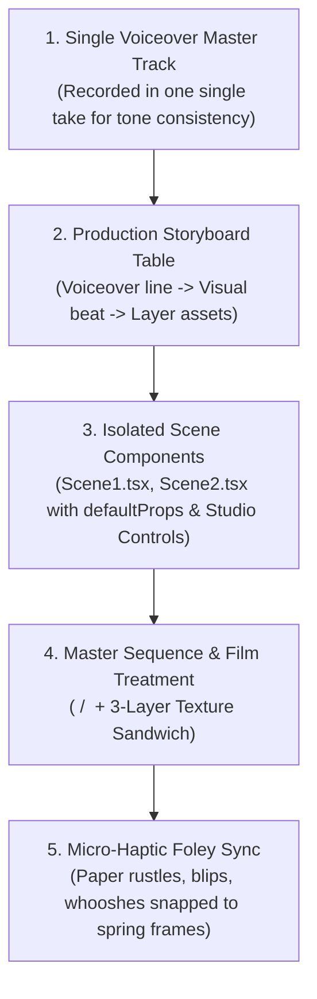

# The Mo Sidd Way: Programmatic Video OS & Motion Graphics Framework

> **Knowledge Base:** Forensic reverse-engineering of all 6 core masterclass tutorials by creator **Mo Sidd** (`@mo-sidd`, ex-Netflix strategist & AI motion graphics pioneer), verified via **236 extracted high-resolution video frames**, verbatim Claude Code prompts, and complete spoken transcripts.  
> **Core Thesis:** *"Code Beats Keyframes."* Zero After Effects, zero manual keyframing, and zero $300 map/animation plugins. Complex motion graphics are treated as deterministic React code, SVG geometry, and CSS physics driven by plain-English AI agent prompts.  
> **Workspace Alignment:** Built for direct modular integration into SaN Video OS (`dmart-video-engine` / `motion-kit/`).

---

## 1. The Core Mental Model: Code vs Keyframes

In traditional editing (Premiere Pro, After Effects), video is a linear raster timeline of pixels and manual bezier keyframes. In the **Mo Sidd Way**, video is a programmatic sequence of React components rendered at 30fps:



### The Invariant Rules of Mo Sidd:
1. **Scene-by-Scene Isolation:** Never build a 30-second or 60-second video inside one monolithic component. Each voiceover sentence is its own standalone `SceneX.tsx`. When Scene 1 is tweaked, Scene 6 cannot break.
2. **The Voiceover as the Master Timeline:** The voiceover duration dictates frame lengths. Visuals are sequenced to narration beats, never the other way around.
3. **Parametric Studio Props (`defaultProps`):** Expose colors, typography sizes, X/Y offsets, scale, and easing curves to Remotion Studio's Inspector panel so visual tuning happens interactively without code re-writes.
4. **Frame-Accurate Agent Prompting:** Never instruct Claude Code with vague times like *"after a few seconds"*. Always quote exact frame numbers from Remotion Studio: *"From frame 54 to 62 ramp motion blur from 0 to 9px, hold for 3 frames, settle to 0 at frame 72."*

---

## 2. The 5 Production Shelves (Ready Off-the-Shelf)

### 📱 Shelf 1: Vertical Viral Reels (9:16)
*Target: Instagram Reels, YouTube Shorts, TikTok (1080x1920 @ 30fps).*

#### 1.1 The 5-to-6 Voice Line Beat Architecture
* A viral reel consists of strictly **5 to 6 voiceover sentences** (~4–5 seconds each), yielding a high-density **25–30 second** total runtime.
* Each voice line maps 1:1 to a dramatic visual set-piece.

#### 1.2 The Weld & Detach Portal Zoom-Through
A signature cinematic opener: flying from an exterior museum/wall directly into a framed photograph.
* **The Slow Push:** Over frames `0 to 46`, ease wall scale from `1.0 to 1.16` so the shot breathes immediately upon opening.
* **The Acceleration:** From frame `46 to 76`, explode wall scale up to `6.8x`.
* **The Weld:** Until frame `62`, lock the photograph and ornate frame together:
  $$\text{contentScale} = 0.369 \times \text{wallScale}$$
  *(They must never drift apart during flight or the illusion shatters).*
* **The Detach:** At frame `62`, the outer gold frame accelerates past the viewport edges while the inner photo settles from `0.75` to `1.0` scale by frame `72`, crossfading from black-and-white to full color.

#### 1.3 The Explicit Blur Burst
Code engines cannot compute natural camera optical motion blur during extreme $6.8\times$ zooms.
* Mo Sidd's trick: Explicitly pulse a CSS filter blur from `0px` to `9px` and back to `0px` across frames `54, 61, 72`, peaking exactly at the fastest detach moment. The human brain perceives this burst as physical lens velocity.

#### 1.4 Character Boil & Multi-Layer Depth
* **Character Boil:** Static cutouts feel dead. Add a gentle shiver:
  $$\text{scale} = 1.0 \pm 0.005 \times \sin(\text{frame} \times 0.2)$$
  $$\text{rotate} = \pm 0.5^\circ \times \sin(\text{frame} \times 0.15)$$
  Snapped to a `12fps step` so it feels like authentic stop-motion paper.
* **Dual-Cloud Parallax:** Place `cloud1.png` moving at `translateX: 0 -> -525px` and `cloud2.png` behind it moving at `0.6x` that speed.

#### 1.5 Skewed Volumetric Ground Contact Shadow
Grounding floating PNG cutouts without 3D software:
* Duplicate the cutout layer -> `filter: brightness(0) blur(7px)` -> `opacity: 0.55`.
* Project onto floor plane: `transform: skewX(-53deg) scaleY(0.3) translateY(20px)`.

#### 1.6 Hold-Keyframe Lighting & Swinging Lamp
* **Swinging Lamp:** Overhead industrial or vintage lamp swinging via a damped sine wave: `rotate: 8° * sin(frame * 0.08)`.
* **Cash/Object Highlight Flicker:** Take the subject cutout, recolor it to luminous chartreuse via CSS (`filter: sepia(1) saturate(5) hue-rotate(18deg)`), and trigger with instant hold-keyframes (no interpolation):
  `[23..28 ON, 29..31 OFF, 32..61 ON, 62..63 OFF, 64..71 ON]` — mimicking a flickering fluorescent shop tube.

#### 1.7 Damped Pendulum Gesture Animation
For kinetic props (e.g. a foam finger wagging "no no no", a pendulum clock, or a ticking sign):
$$\text{rotate} = 28^\circ \times \cos(t \times 0.52) \times e^{-0.042 \times t}$$
Anchored at `transform-origin: bottom center`.

---

### 🎙️ Shelf 2: Long-Form & Vox Explainer Documentaries (16:9)
*Target: YouTube Long-Form, Chapter Segments, Documentary Explainers (1920x1080 @ 30fps).*

#### 2.1 The Zero-Plugin Vector Map Engine
Replaces $300 After Effects geo-plugins with free open standards in pure SVG:
* **`world-atlas`:** Pre-packaged TopoJSON boundaries of countries and landmasses.
* **`topojson-client`:** Unpacks mesh arcs and polygon boundaries into GeoJSON features.
* **`d3-geo`:** Spherical projections (`geoMercator`, `geoEqualEarth`, `geoOrthographic`) converting coordinates $([\text{lon}, \text{lat}])$ into 2D screen SVG paths $(d)$.
* **Camera Moves:** To animate camera moves, simply interpolate the projection's `.scale()` and `.center([lon, lat])`!

#### 2.2 The Continuous Shot Hand-Off Invariant
* In multi-scene documentary explainers, **every scene must start on the exact camera coordinate and frame where the previous scene ended**.
* `Scene1` ends zoomed into country coordinates $[\text{lon}_A, \text{lat}_A]$ at scale $S$. `Scene2` mounts at $[\text{lon}_A, \text{lat}_A]$ at scale $S$ before flying to $[\text{lon}_B, \text{lat}_B]$. The viewer experiences one continuous, seamless broadcast documentary shot.

#### 2.3 The "Counter-Scale Trick" (Pixel-Perfect Punch-Ins)
* **The Problem:** In a timeline or chart with a camera punch-in from `scale: 1.0` to `2.8x`, typography and cutout assets rendered at base scale blow up into enormous, blurry elements.
* **The Mo Sidd Solution:** Wrap each milestone's text and assets in a counter-scale container:
  $$\text{wrapperScale} = \frac{1}{\text{cameraScale}} = \frac{1}{2.8} \approx 0.357$$
  When the camera punches in to $2.8\times$, the wrapper scale and camera zoom cancel out perfectly ($2.8 \times \frac{1}{2.8} = 1.0$), rendering text at razor-sharp design size right when the camera parks!

#### 2.4 Live Stock Video Screen-Blend Keying
To composite explosion stock footage, fireballs, or smoke plumes on dark backgrounds without greenscreen:
* Set `mix-blend-mode: screen`.
* Adjust contrast to lift mid-tones and crush dark blacks: `filter: contrast(1.4) brightness(1.1)`.
* Apply a feathered edge mask: `mask-image: radial-gradient(circle, black 60%, transparent 100%)`.

---

### 📊 Shelf 3: Vox-Style Editorial Data & Animated Charts
*Target: High-Retention Financial Charts, Comparison Metrics, Economic Visualizations.*

#### 3.1 The 4-Layer Print/Paper Texture System
The secret difference between a generic digital chart and a $10,000 Vox/Guardian editorial graphic:
1. **Paper Base:** Textured background `#F7F4EC` (cream vintage book paper).
2. **Marker Edge (`<feDisplacementMap>`):** SVG fractal noise filter distorting vector straight lines into rough, pen-drawn contours.
3. **Grain in Fills:** Colored bar fills contain a subtle textured noise overlay rather than flat digital hex colors.
4. **Grain Over Frame:** Global 35mm grain plate (`mix-blend-mode: overlay` at 8–12% opacity).

#### 3.2 The Line "Boil" vs "Buzz"
* **The Boil:** In traditional hand-drawn animation, lines gently shiver because each frame was traced by hand.
* **The Failure Mode ("The Buzz"):** Generating fresh pseudo-random noise every frame makes the line vibrate violently, distracting the viewer.
* **The Mo Sidd Boil Formula:** Take two static noise textures and crossfade between them cyclically, with weights always summing to 1.0:
  $$W_1 = \frac{1 + \sin(\text{frame} \times 0.15)}{2}, \quad W_2 = 1.0 - W_1$$
  The edges breathe organically without jittering.

#### 3.3 Staggered Bar Charts with Tip-Riding Counters
* Bars grow left-to-right staggered by 3–4 frames using `Easing.out(Easing.cubic)`.
* Each bar's dollar/numeric value rides the tip of the bar during expansion:
  $$\text{tipX} = \text{barWidth} + 16\text{px}$$
* The number counts up dynamically:
  $$\text{displayValue} = \text{Math.round}(\text{interpolate}(\text{frame}, [\text{start}, \text{end}], [0, \text{target}]))$$

#### 3.4 Parliament / Chamber Arc Wave
* Dots arranged in a curved hemi-cycle lattice (Guardian/Vox seat breakdown).
* Wave reveal: A single sweep traveling left-to-right across the chamber.
* Physics: Each dot pops in with `damping: 19`, `stiffness: 280` with a ~12% overshoot.

---

### 🎨 Shelf 4: $1,000 Collage & Mixed-Media Animation
*Target: Editorial storytelling, historical case studies, brand retrospectives.*

#### 4.1 The 4-Prompt Workflow
1. **Prompt 1 (Decode Reference & Storyboard):** Feed reference URL/video to Claude Code -> extract beat sheet + Master Asset Sheet (shopping list).
2. **Prompt 2 (Asset Generation Pack):** Generate/collect all cutouts as transparent PNGs with consistent art direction (torn paper fibers, sticker borders, visible grain).
3. **Prompt 3 (Layer Construction):** Assemble background, multi-strip parallax ocean/scenery, and hero subjects.
4. **Prompt 4 (Audio & Foley):** Synchronize voiceover, soundtrack, and micro-haptic foley.

#### 4.2 The "Sandwich Trick" (Occlusion Without 3D)
To place characters inside a vehicle or structure (e.g. pilgrims inside a boat, CEO in a boardroom):
* **Layer A (Bottom):** Interior/back hull cutout.
* **Layer B (Middle):** Character cutout (e.g. pilgrims, driver).
* **Layer C (Top):** Front hull/rim cutout sliced from the exact same source asset.
* Result: 100% natural physical occlusion with zero visible seams.

#### 4.3 Selective Hybrid Posterized Time
* **The Trap:** Posterizing the entire video down to 12fps makes the entire playback look stuttery and broken.
* **The Golden Rule:** Keep camera moves, water waves, and backgrounds running at **smooth 24fps / 30fps**. Only posterize character cutouts, floating props, and flying paper:
  $$\text{steppedFrame} = \text{Math.floor}\left(\frac{\text{frame}}{2.5}\right) \times 2.5$$
* The contrast between the smooth camera velocity and the stepped stop-motion characters creates the signature high-end handmade collage aesthetic!

---

### 🎛️ Shelf 5: Foley & Micro-Haptic Audio Engineering

#### 5.1 Single-Pass Voiceover Generation
* Always paste all voiceover lines into ElevenLabs (or recorded master voice) in **one single continuous take**.
* This preserves room acoustics, narrator inflection, and emotional cadence across scenes.

#### 5.2 The 3-Layer Audio Pyramid
1. **Master Voiceover (Top):** Anchors the timeline. Normalized gain (+3dB), center channel.
2. **Atmospheric Bed (Middle):** Low drone, jaunty folk waltz, or tension bed at -18dB.
3. **Micro-Haptic Foley (Bottom):** Exact frame-quantized sound effects triggered on physical actions:
   - Paper unroll / rustle on scroll entry.
   - Wooden creak on boat tilt.
   - Water splash on wave crest.
   - Marker squeak on highlight reveals.
   - Muted thud on card landings.

---

## 3. The Mo Sidd Claude Code Prompt Engineering Playbook

To prompt Claude Code to generate Remotion compositions matching this quality standard, use Mo Sidd's structured 5-part prompt anatomy:

```text
The build: [Composition name, aspect ratio (1080x1920 or 1920x1080), 30fps, duration in frames & seconds, previewable in Remotion Studio].

The copy: [Background hex color, typography choices (e.g. bold serif headline, italic sub-deck), exact highlight phrasing in marker yellow, citation text].

The assets: [List of transparent PNG cutout assets in /public or /assets, e.g. portraits, facades, vehicles, paper textures].

The look: [3-Layer Texture Sandwich: window-shadow.png, grain.jpg, grunge.jpg, halftone newsprint dot filter, warm offset drop shadow, filmic scanlines].

The motion: [Chronological step-by-step choreography using exact frame ranges:
- Eased push/breathe on opener
- Staggered spring pop-ins (damping, stiffness)
- Explicit blur burst during camera accelerations
- Counter-scale wrappers on depth punch-ins
- Selective 12fps posterized step on cutouts while environment stays 30fps].
```

---

## 4. Reusable Motion Kit Code Components

The following standardized components are codified in `dmart-video-engine/src/motion-kit/mosidd/`:

### 4.1 `CounterScaleWrapper.tsx`
```tsx
import React from 'react';

interface Props {
  cameraScale: number;
  children: React.ReactNode;
  style?: React.CSSProperties;
}

export const CounterScaleWrapper: React.FC<Props> = ({ cameraScale, children, style }) => {
  const counterScale = cameraScale > 0 ? 1 / cameraScale : 1;
  return (
    <div
      style={{
        transform: `scale(${counterScale})`,
        transformOrigin: 'center center',
        ...style,
      }}
    >
      {children}
    </div>
  );
};
```

### 4.2 `SelectivePosterize.tsx`
```tsx
import React from 'react';
import { useCurrentFrame } from 'remotion';

interface Props {
  step?: number; // e.g. 2.5 for 12fps in 30fps timeline
  children: (posterizedFrame: number) => React.ReactNode;
}

export const SelectivePosterize: React.FC<Props> = ({ step = 2.5, children }) => {
  const frame = useCurrentFrame();
  const posterizedFrame = Math.floor(frame / step) * step;
  return <>{children(posterizedFrame)}</>;
};
```

### 4.3 `SkewedGroundShadow.tsx`
```tsx
import React from 'react';
import { Img } from 'remotion';

interface Props {
  src: string;
  skewAngle?: number; // default -53deg
  blur?: number; // default 7px
  opacity?: number; // default 0.55
  style?: React.CSSProperties;
}

export const SkewedGroundShadow: React.FC<Props> = ({
  src,
  skewAngle = -53,
  blur = 7,
  opacity = 0.55,
  style,
}) => {
  return (
    
  );
};
```

### 4.4 `LineBoilFilter.tsx` (SVG Breathing Noise)
```tsx
import React from 'react';
import { useCurrentFrame } from 'remotion';

export const LineBoilFilter: React.FC = () => {
  const frame = useCurrentFrame();
  const weight1 = (1 + Math.sin(frame * 0.15)) / 2;
  const weight2 = 1.0 - weight1;

  return (
    <svg style={{ position: 'absolute', width: 0, height: 0 }}>
      <defs>
        <filter id="line-boil" x="-10%" y="-10%" width="120%" height="120%">
          <feTurbulence type="fractalNoise" baseFrequency="0.04" numOctaves="2" seed="42" result="noise1" />
          <feTurbulence type="fractalNoise" baseFrequency="0.04" numOctaves="2" seed="84" result="noise2" />
          <feComposite in="noise1" in2="noise2" operator="arithmetic" k1="0" k2={weight1} k3={weight2} k4="0" result="blendedNoise" />
          <feDisplacementMap in="SourceGraphic" in2="blendedNoise" scale="2.5" xChannelSelector="R" yChannelSelector="G" />
        </filter>
      </defs>
    </svg>
  );
};
```

---

## 5. Summary Checklist for Every New SaN Reel & Video

Before writing any Remotion code or rendering:
- [ ] **Voiceover First:** Is the voiceover generated and locked as the single source of truth?
- [ ] **Choreography Table:** Has the 2-column beat sheet (Narration vs Visual Layer Sandwich) been confirmed?
- [ ] **Scene-by-Scene Isolation:** Is each beat authored in an independent `SceneX.tsx`?
- [ ] **Texture Sandwich Applied:** Are `paper-base`, `window-shadow`, `grain.jpg`, and `grunge.jpg` active?
- [ ] **Continuous Shot Continuity:** If doing maps or document pans, does each scene mount at the exact coordinates the previous scene ended?
- [ ] **Selective Posterization:** Are cutouts stepped at 12fps while the camera moves smoothly at 30fps?
- [ ] **Foley Snapped:** Are paper rustles, clicks, and whooshes synced to exact spring impact frames?
- [ ] **Remotion Studio Local Review:** Has the edit been reviewed in Remotion Studio before final render?
