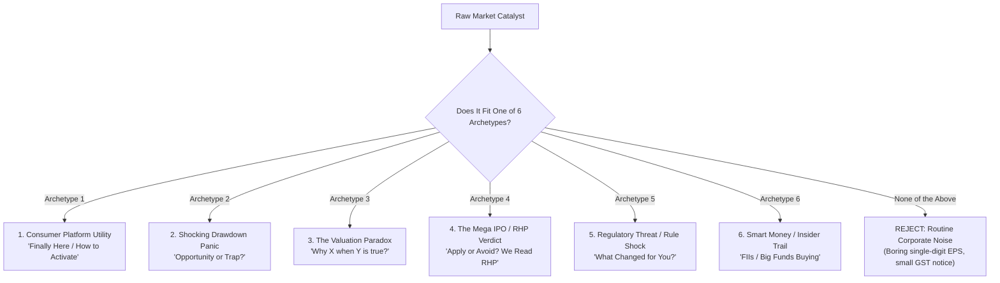

# Viral Financial Shorts Intelligence: The Groww & INDmoney Engineering Framework

> **Knowledge Base:** Forensic analysis of 150+ YouTube Shorts from `@Groww` (1.5M+ views analyzed) and `@INDmoney` (1M+ views analyzed).  
> **Target Production Speed:** Concept to final CapCut + Remotion render in under 60 minutes.  
> **Core Channel Objective:** Transform complex market events into high-retention, high-utility financial short videos under the **Happy Investing** ethos (Zero Fear, Zero Greed, Pure Fact).

---

## 1. Forensic Discovery: The Timing Lag & Speed-to-Market Matrix

Empirical analysis of video upload timestamps vs. underlying news/catalyst timestamps reveals that virality is governed by three strict speed windows:

| Category | News Catalyst Event | Video Upload Lag | Target Upload Window | Real Channel Case Study |
| :--- | :--- | :--- | :--- | :--- |
| **Breaking Drawdown Panic** | Sudden stock crash, Supreme Court order, fraud raid | **4 to 8 Hours** | Same day: **6:00 PM – 9:00 PM IST** | **YES BANK -18%** (Supreme Court AT1 order morning of Oct 15 $\to$ INDmoney short live Oct 16, 7:00 PM IST). |
| **Platform / Consumer Feature** | Feature rollout on top brokers (Zerodha, Groww, Angel) | **2 to 12 Hours** | Same day as user discovery | **Zerodha US Stocks** (SaN's reel published within 1 hour $\to$ 10k views; INDmoney US stocks feature guide). |
| **Regulatory Shock** | Official SEBI circular, RBI repo rate, tax rule changes | **12 to 24 Hours** | Next day market open or evening | **SEBI New CAS Rules 2026** (Circular released Oct 15 $\to$ INDmoney video live Oct 16, 9:00 PM IST). |
| **Contrarian Quarterly Review** | Big earnings report (Sales up but margins squeezed) | **24 to 48 Hours** | First trading session evening | **DMart Sales Up 18%** (Results released Sat Oct 10 $\to$ INDmoney video live Mon Oct 12, 7:00 PM IST). |
| **Valuation Paradox / Screening** | Historical screening anomaly (High ROE, Low PE, Smart Money) | **Evergreen / Weekend** | Saturday / Sunday evening | **Colgate Down 55% despite 80% ROE** (Groww, 31k views); **FIIs Buying 63% Down Leader** (Groww, 479k views). |

> [!IMPORTANT]
> **The 7:00 PM – 9:30 PM IST Golden Window:** Over 85% of top-performing shorts from both INDmoney and Groww are uploaded between **7:00 PM and 9:30 PM IST**. This is when retail investors finish work, check their portfolios, see the day's red/green closes, and search social media asking *"Why did my stock move today?"*

---

## 2. The 6 Topic Archetypes (The Only Content That Goes Viral)

Both Groww and INDmoney completely ignore 90% of routine corporate press releases. Every single viral short maps strictly to one of these **6 Archetypes**:

---

### Archetype 1: Consumer Platform Utility & Direct Action ("Finally Here / How-To")
- **Why It Works:** Solves immediate personal friction. The viewer feels empowered because they can open their app and take immediate action.
- **Hook Formula:** `"Finally, [Platform] activated [Feature]. Here is how to turn it on in 30 seconds."`
- **Real Examples:**
  - *Zerodha US Stock Investing Activation* (SaN’s 10k reel).
  - *How to Check Your Net Worth and Portfolio Breakdown on Groww* (Groww).
  - *NUDGES, now live for US Stocks on INDmoney* (INDmoney).
- **Remotion Recipe:** Phone screen recording (`scale: 1.323x`, `Y-offset: +0.22`) + `UIRippleHighlight.tsx` (pulsing touch guides) + `StepCalloutBadge.tsx` (Step 1, Step 2, Step 3).

---

### Archetype 2: The Shocking Drawdown ("Opportunity or Trap?")
- **Why It Works:** Exploits psychological **Loss Aversion**. Holders are terrified; prospective buyers are wondering if it’s a bargain.
- **Hook Formula:** `"[Stock] crashed [X]% today! Is this an opportunity or a dangerous trap?"`
- **Real Examples:**
  - *Cyient DLM crashed 15% : Opportunity or trap?* (Groww)
  - *YES BANK -18%: what investors need to know…* (INDmoney)
  - *Why did Policybazaar’s stock fall 36% today?* (Groww)
  - *Inox Green Stock Crashes 35% What's Wrong?* (Groww)
- **Remotion Recipe:** `FinancialLineChart.tsx` (red gradient crash line dipping into a red drawdown pill) + `StockTickerBadge.tsx` + `NewspaperHeadline.tsx` (highlighting the cause of the drop) + Rubber Stamp (`"TRAP"` or `"OPPORTUNITY"`).

---

### Archetype 3: The Valuation Paradox ("Why is X happening despite Y?")
- **Why It Works:** Creates high intellectual friction. The headline breaks conventional common sense.
- **Hook Formula:** `"Why is [Company] down [X]% despite reporting [Amazing Metric]?"` or `"A [Low PE] stock that just reported [High Growth]% profit!"`
- **Real Examples:**
  - *Why is Colgate down 55% despite 80% ROE?* (Groww, 31k views)
  - *A 10x PE Stock That Reported 100% Profit Growth* (Groww, IIFL Finance breakdown)
  - *DMart Share: Sales Up 18%, But Should Investors Worry?* (INDmoney)
  - *DMart Is Down 43% — But Is It Still Expensive?* (Groww)
- **Remotion Recipe:** `ComparisonVersus.tsx` (Split-screen: Metric A in Green vs Metric B in Red) + animated counter (`toLocaleString('en-IN')`).

---

### Archetype 4: The Mega IPO & 400-Page RHP Deconstruction ("Apply or Avoid?")
- **Why It Works:** Relieves decision fatigue. Retail investors are overwhelmed by IPO hype and grey market premiums (GMP). They want a trusted expert to read the dense regulatory filing and give an unbiased verdict.
- **Hook Formula:** `"We read the 400-page [Company] RHP so you don't have to! Should you Apply or Avoid?"`
- **Real Examples:**
  - *Jio IPO 2026: ₹30,213 Crore IPO! Should You Invest?* (INDmoney, 12k views)
  - *HD Fire Protect IPO: We Read the RHP So You Don't Have To!* (INDmoney, 20k views)
  - *Tonbo Imaging IPO, Defence sector player: Why investors are excited* (INDmoney)
- **Remotion Recipe:** 2.5D document perspective card + animated yellow marker highlighter (`NewspaperHeadline.tsx`) + Rubber Stamp verdict (`"APPLY"` or `"AVOID"`).

---

### Archetype 5: Regulatory Threat & Market Rule Shocks ("What Changed for You?")
- **Why It Works:** Fear of non-compliance or systemic disruption. Investors want to know: *"Will this hurt my portfolio or my broker?"*
- **Hook Formula:** `"SEBI just changed the rules for [Market Segment]. Here is what it means for your money."`
- **Real Examples:**
  - *SEBI New CAS Rules 2026: What Changed for Investors?* (INDmoney)
  - *Why Did BSE and Angel One Shares Jump 5%? SEBI Review Explained* (INDmoney)
  - *Bank Nifty Weekly Expiry Bids Adieu: The Impact on Retail Traders* (Groww / ET)
- **Remotion Recipe:** Official SEBI letterhead / circular with animated highlighter sweeping across the specific circular clause number and operational deadline.

---

### Archetype 6: Smart Money & Institutional Trail ("What Are Insiders Buying?")
- **Why It Works:** Social proof and copying elite players. If institutional whales are accumulating a fallen stock, retail investors want in.
- **Hook Formula:** `"FIIs and top mutual funds are quietly buying this [X]% down market leader."`
- **Real Examples:**
  - *FIIs Are Buying This 63% Down Market Leader* (Groww, 479,000 views!)
  - *Why do Parag Parikh and SBI hold 9% each in this Smallcap stock?* (Groww, CMS Info Systems breakdown, 97,000 views)
  - *Promoters Buying While Stock Crashes 80%?* (Groww, 52,000 views)
- **Remotion Recipe:** Institutional holding bar chart + Stock ticker pill with FII shareholding percentage jump tag.

---

## 3. The "Boring Corporate Filter" (The Rejection Matrix)

To eliminate noise, any raw market story that does **not** satisfy one of the 6 archetypes must be ruthlessly discarded:

| Raw News Item | Typical Scraper Output | Groww / INDmoney Decision | Why It Gets Rejected |
| :--- | :--- | :--- | :--- |
| **PGHH Q2 EPS ₹263 up 2%** | Surface as "Top Earnings" | **REJECT** | Routine single-digit growth. No paradox, no crash, no drama. |
| **Saraswati Saree ₹32 Lakh GST Notice** | Surface as "ITC Penalty" | **REJECT** | Tiny immaterial figure relative to market cap; routine legal dispute. |
| **Company Appoints New Independent Director** | Surface as "Board Action" | **REJECT** | Zero consumer or portfolio relevance. |
| **Sensex rises 120 points in quiet trade** | Surface as "Market Close" | **REJECT** | Routine daily noise; zero evergreen or contrarian value. |
| **Zerodha activates US Investing** | Standard news feed ignores it | **ACCEPT (Priority 1)** | Fits **Archetype 1 (Consumer Utility)**. Huge organic demand, direct action. |
| **BSE / Angel One drops 5% on SEBI CAS** | Surface as "Stock Move" | **ACCEPT (Priority 1)** | Fits **Archetype 5 (Regulatory Shock) & Archetype 2 (Drawdown)**. |

---

## 4. How to Test Candidate News Items Against the Skill

When reviewing daily market items:
1. **Pass the Item Through the 6 Archetypes:** Does it trigger Consumer Utility, Drawdown Panic, a Valuation Paradox, an IPO Verdict, a Regulatory Shock, or an Insider Trail? If no, discard immediately.
2. **Identify the Catalyst Metric:** Is there a striking number? (`-18%`, `80% ROE`, `10x PE`, `₹30,213 Cr`, `400-page RHP`).
3. **Formulate the Hook in 3 Seconds:** Craft the question or paradox statement.
4. **Select the Remotion Visual Element:** Match to the pre-built components in `dmart-video-engine/src/components/`.
5. **Publish in the Golden Window:** Record within hours; publish between 7:00 PM and 9:30 PM IST.
