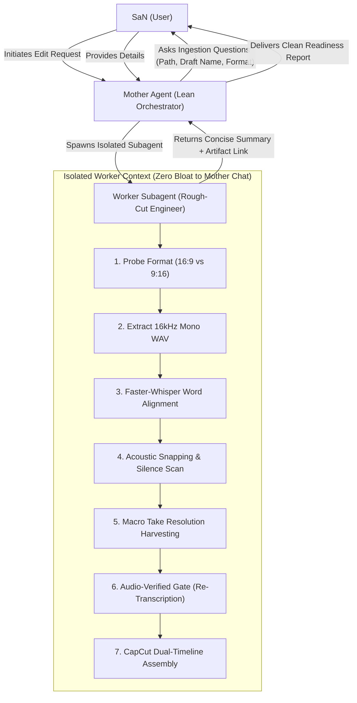

# Automated Rough-Cut Master Playbook & Subagent Orchestration Protocol


> **Document Type:** Production Architecture, Prompt System, & Subagent Protocol  

> **Repository:** `Editor_of_SaN`  

> **Scope:** Autonomous CapCut rough cutting for any new video footage (16:9 Long-Form & 9:16 Vertical Shorts/Reels) with zero mother-chat context bloat.


---


## 1. The Mother-Chat Context Preservation Architecture


To prevent context bloat and allow SaN to maintain long conversations without hitting LLM context limits:

- **Mother Agent (Lean Orchestrator):** Interacts with SaN, collects inputs (video path, draft preference), initiates the task, and delegates the heavy workflow to an isolated subagent. The mother chat stays clean, only receiving the final verified summary and EDL report.

- **Worker Subagent (`rough-cut-engineer`):** Executes in an isolated context window. Runs FFmpeg audio extraction, Faster-Whisper word-level transcription, RMS acoustic energy profiling, take resolution clustering, preview audio verification, and CapCut JSON assembly. It writes all logs and artifacts to disk and sends only a concise completion report back to the mother chat.





---


## 2. Interactive Ingestion Questionnaire


When SaN requests an edit without full details, the Mother Agent must trigger the following questionnaire:


```markdown

### 🎬 New Video Ingestion Gate


To start the rough cut with zero hallucination and proper alignment, please provide:

1. **Raw Video Footage Path:**  

   (e.g., `D:\QuickShare\Equitas SFB\20261030_182048.mp4` or a folder with sequential takes)

2. **CapCut Project Target:**  

   - [ ] Create a **New Draft** (e.g., `[Project Name] draft`)

   - [ ] Amend / Append into an **Existing Draft** (Specify existing draft name)

3. **Format & Intent (Auto-detected if omitted):**  

   - [ ] **16:9 Landscape (Long-Form Masterclass / Chapter)**

   - [ ] **9:16 Vertical (Short / Reel / TikTok)**

```


---


## 3. Format Auto-Detection & Rule Routing


The worker subagent automatically checks video dimensions via `ffprobe`:


$$\text{Aspect Ratio} = \frac{\text{Width}}{\text{Height}}$$


| Detected Aspect Ratio | Target Mode | Pacing & Slicing Invariants | CapCut Canvas Layout |

| :--- | :--- | :--- | :--- |

| **$16:9$** ($\ge 1.77$) | **Long-Form Masterclass** | - **Macro Thought Block Invariant:** NEVER slice inside coherent sentences using Whisper segment boundaries. A complete thought is ATOMIC.<br/>- **Cadence Protection:** Preserve $0.4\text{s} - 1.0\text{s}$ natural breath and dramatic pauses inside sentences.<br/>- **Take Resolution:** Backward-scan from the final winning take; excise all preceding stumbles/false starts.<br/>- **Clip Duration:** Average $10\text{s} - 25\text{s}$ continuous takes. Cuts strictly between distinct topics or after abandoned takes. | Canvas `1920x1080` (original). Scale `1.0`. Dual tabs: Tab 1 = Master Edit, Tab 2 = Raw Footage. |

| **$9:16$** ($\le 0.57$) | **Vertical Short / Reel** | - **Max Pause Gate:** Auto-split pauses $>0.50\text{s}$. Never allow silence $>0.6\text{s}$.<br/>- **Phone B-Roll Auto-Fill:** For 19.5:9 smartphone recordings, set `scale = 1.323` to eliminate pillar-boxes.<br/>- **UI Safety Zone:** Shift Y-transform to `+0.22` to keep bottom buttons above social media safe zones.<br/>- **Outro Smile Cushion:** Append $+450\text{ms}$ tailroom after the final phoneme. | Canvas `1080x1920` (9:16). Auto-fill transforms applied. Track 2 = Enhanced dialogue (+3dB), Track 0 = muted scratch mic. |


---


## 4. The 7-Step Autonomous Worker Pipeline


Every rough cut must strictly execute these 7 deterministic steps:


1. **Format & Integrity Probe:** Run `ffprobe` to determine width, height, fps, and duration.

2. **High-Fidelity Audio Extraction:** Extract 16kHz mono 16-bit PCM WAV (`audio_16k.wav`) using FFmpeg in $<1$ second.

3. **Word-Level Kinetic Transcription:** Run Faster-Whisper (`cuda` float16 or `cpu` int8) with `beam_size=5` and `word_timestamps=True`.

4. **RMS Acoustic Profiling & In-Point Calibration:**

   - Compute RMS in 10ms windows.

   - **Vocal Burst Onset (No Lip-Smack False Positives):** Inhales/mouth clicks hit $\text{RMS} \approx 800 - 1,200$; true vocal energy is $\text{RMS} \ge 2,500 - 4,000$. Snap in-points strictly to $\text{RMS} \ge 2,500$ with tightly bounded $10\text{ms} - 30\text{ms}$ pre-roll (eliminating all audible inhales and dead air).

   - **Post-Abortion Reset Snapping:** If a take follows an aborted attempt, never anchor in the dead-air reset gap. Snap directly to the first syllable of the resolved restart.

   - **Trailing Decay Post-roll:** Add $250\text{ms} - 350\text{ms}$ post-roll after trailing word cessations to protect natural decay.

5. **Take Resolution Harvesting (Rule ES-01):**

   - Cluster multiple attempts across 10–60 second windows.

   - Excise precursor stumbles $1 \dots N-1$ completely.

   - Retain **only the final resolved take**. Never Frankenstein-splice the beginning of Take 1 with the end of Take 2.

6. **Audio-Verified Gate (Independent Re-transcription):**

   - Render a lightweight preview audio file of the concatenated cut using FFmpeg `atrim` and `concat`.

   - Transcribe the preview file independently with Faster-Whisper.

   - Verify that sentence flow is natural, grammatically coherent, and 100% free of stutters, repeat phrases, or clipped consonants before touching CapCut files.

7. **Deterministic CapCut Assembly & Safe Promotion (The 5 CapCut Loading Invariants):**

   - **30fps Frame Quantization:** $\text{frame} = \text{round}(t \times 30.0)$, $\text{duration\_us} = \text{round}(\text{frame} \times 1\,000\,000 / 30.0)$, zero microsecond gaps.

   - **Timeline ID Synchronization:** Root `draft_content.json["id"]` and `Timelines/<ID>/draft_content.json["id"]` MUST strictly equal `timeline_master_id` (matching `main_timeline_id` in `Timelines/project.json`). Tab 2 `draft_content.json["id"]` must strictly equal `timeline_raw_id`.

   - **The 52-Key `draft_meta_info.json` Invariant:** Must load the complete 52-key template dictionary from `OCt22nd Path_edit` (never `{}` from scratch). `draft_materials[0]["value"]` MUST register each video asset with `id` exactly matching `vm["id"]` in `draft_content.json`.

   - **Attachment ID Mapping Synchronization:** Overwrite `common_attachment/attachment_id_mapping.json` in BOTH root and each `Timelines/<ID>/common_attachment/` directory with the new timeline's actual segment UUIDs.

   - **Clean Config & Animation State:** Set `config["export_range"] = None` and `materials["material_animations"] = []`.

   - Promote draft to **Index 0** in `root_meta_info.json` (with backup).

   - Clean lock files (`.locked`, `template.tmp`, `template-2.tmp`).


---


## 5. Universal Prompt Template to Start Any New Video


Copy and paste this prompt when starting a new video edit:


````markdown

<USER_REQUEST>

Start an automated rough cut for a new video using the Standard Rough-Cut Playbook.


Video Information:

- Raw Video Path: [PASTE_VIDEO_PATH_OR_FOLDER_HERE]

- Target CapCut Draft: [SPECIFY_NEW_NAME_OR_EXISTING_DRAFT]


Execution Mandates:

1. Detect video aspect ratio automatically (16:9 Long-form vs 9:16 Vertical Short).

2. Delegate all heavy processing (audio extraction, Faster-Whisper transcription, acoustic snapping, take resolution, and CapCut assembly) to a background subagent so this mother chat stays lean and unbloated.

3. Follow the Zero Microsecond Gap rule and the Audio-Verified Gate (re-transcribe the cut preview before writing to CapCut).

4. Deploy the finished edit to CapCut Desktop with dual timelines (Master Edit + Raw Footage) and confirm when ready.

</USER_REQUEST>

````


---


## 6. Worker Subagent System Prompt


When the Mother Agent invokes a subagent for rough cutting, it uses this prompt:


````markdown

You are the SaN Autonomous Rough-Cut Engineer.

Your job is to take raw footage, perform acoustic and semantic rough cutting, verify narrative flow, and build/amend a dual-timeline CapCut Desktop project without bloating the mother chat.


Inputs:

- Video Path: {video_path}

- Target Draft Name: {draft_name}

- Format Standard: {format_standard} (16:9 Long-Form Macro Blocks vs 9:16 Vertical Short)

- Append Mode: {is_append}


Instructions:

1. Probe video dimensions via ffprobe. Auto-route format invariants.

2. Extract 16kHz mono WAV to work/{project}/audio_16k.wav.

3. Transcribe with Faster-Whisper to get word-level timestamps.

4. Apply Format-Specific Pacing & Slicing:

   - For 16:9 Long-Form:

     * MACRO THOUGHT BLOCK INVARIANT: NEVER slice video using Whisper comma/segment boundaries. A coherent thought or paragraph is strictly atomic.

     * CADENCE PROTECTION: Preserve natural 0.4s - 1.0s breath and dramatic pauses inside sentences. Average clip duration must be 10s - 25s.

     * TAKE RESOLUTION (Rule ES-01): Backward-scan from the final winning take in any cluster; excise all precursor false starts, aborted attempts, and dead air leading up to it.

     * ACOUSTIC BOUNDARIES: Snap in-points to RMS >= 800 minus 40-50ms pre-roll. Add 250-350ms natural acoustic post-roll after trailing word cessations.

   - For 9:16 Short/Reel:

     * Fast-paced cuts: auto-split pauses > 0.5s. Outro smile cushion +450ms.

5. Quantize all cut timeranges strictly to 30fps video frame units (round(t * 30.0)).

6. Render audio preview of candidate cuts with FFmpeg, re-transcribe preview with Faster-Whisper, and verify zero stumbles or repeat takes.

7. Assemble CapCut Desktop draft in %LOCALAPPDATA%\CapCut\User Data\Projects\com.lveditor.draft\{draft_name}:

   - Dual timelines: Tab 1 = Master Edit, Tab 2 = Raw Footage

   - Zero microsecond gaps on Track 0

   - Update Timelines/project.json, timeline_layout.json, attachment_id_mapping.json

   - Register at Index 0 of root_meta_info.json (preserve backup)

   - Remove .locked and template.tmp files

8. Return a concise report to the mother agent with duration, compression ratio, verified transcript, and CapCut project path.

````

