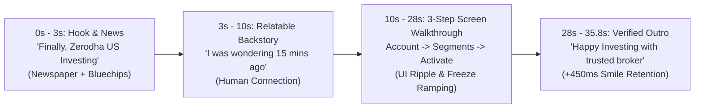

# Case Study: Zerodha US Stocks 10K+ Views Instagram Reel & The "Happy Investing" Winning Formula

> **Document Type:** Operational Knowledge Base & Production Blueprint  
> **Source Project:** `work/US_Stock_Zerodha/`  
> **Live Reel Link:** [Instagram Reel (10K+ Views)](https://www.instagram.com/reel/DerxnhABwpk/?vrfl=MWtodDl5NDR6ZWo0Mw==)  
> **Turnaround Time:** ~60 Minutes from concept to final export  
> **Core Milestone:** 10,000+ Organic Views within 24 hours  

---

## 1. Executive Summary & Why It Worked

On October 19, 2026, Zerodha activated its long-awaited US stock investing segment. Within minutes of discovering the feature, SaN recorded a natural 60-second video explaining how to activate it, which was rapidly processed through our Remotion + CapCut pipeline into a high-velocity, clean reel.

The reel broke through to 10k+ views because it satisfied the **Golden Trifecta of Financial Content**:
1. **High Immediate Utility (Zero Fluff):** It answered a specific, urgent question retail investors had right that minute: *"How do I actually turn this on?"*
2. **The "Happy Investing" Brand Moat:** Completely free of fake urgency, doom-mongering, or get-rich-quick hype. It was honest, calm, factual, and empowering.
3. **High-Retention Motion Graphics (INDmoney/Groww Framework):** Visual proof delivered every 1.5–2.0 seconds (animated press clippings, highlighter sweep, UI ripple taps, and blue-chip stock pills) kept viewers glued without distracting from the message.
4. **Rapid Turnaround Speed (< 1 Hour):** Speed-to-market is the #1 lever for news-driven virality. Publishing while the topic is peaking captures maximum algorithm distribution.

---

## 2. The "Happy Investing" Content Philosophy vs. Industry Clichés

Most financial influencers rely on extreme emotional manipulation. Happy Investing deliberately operates on the opposite frequency:

| Dimension | Typical Social Media Finance Reels | The "Happy Investing" Standard |
| :--- | :--- | :--- |
| **Hook Emotion** | **Fear & Panic:** *"Is Indian market crashing? US stocks will save you!"* | **Fact & Curiosity:** *"Finally, Zerodha activated US investing. Here is how to turn it on."* |
| **Return Promise** | **Greed & Hype:** *"Make 100x on Nvidia and Tesla!"* | **Prudence & Perspective:** *"Diversify with a trusted broker; understand the steps."* |
| **Tone of Voice** | Sensationalist, lecturing guru, loud sound effects. | Authentic, friendly, helpful peer (*"I was also wondering 15 minutes ago, so thought of sharing"*). |
| **Evidence Standard**| Vague claims, stock charts without dates, clickbait headlines. | Verified UI screenshots, official circulars/press releases, exact highlighter callouts. |
| **Core Goal** | Viral outrage or impulse clicks. | **Cut through the noise, tell only what is fact, build lifelong trust.** |

---

## 3. Video Anatomy Breakdown (The 35.80s Structure)

### Detailed Section Metrics:
1. **The Hook (0:00 - 0:03):**
   - Spoken words: *"Finally, Zerodha activated the US investing segment."*
   - Visual: 2.5D Animated Newspaper Card (`NewspaperHeadline.tsx`) popping in with publication masthead and simulated yellow highlighter sweeping across `"US INVESTING"`.
   - Floating Bluechip Ticker Bar (`USBluechipTickerBar.tsx`) showing Apple, Microsoft, Google, and Nvidia pills to visually anchor the US investing theme instantly.
2. **The Human Connection (0:03 - 0:10):**
   - Spoken words: *"If you are also wondering how to activate it before 15 minutes, I was also wondering and searching here and there, but found a way just thought of sharing that across with you."*
   - Style: Natural conversation. No corporate script.
3. **Tactical Execution / Walkthrough (0:10 - 0:28):**
   - Phone screen recording scaled to `1.323x` to eliminate black borders on 9:16 vertical canvas.
   - Panned up (`Y-offset +0.22`) to place critical bottom buttons safely above Instagram’s caption / action bar overlay.
   - Pulsing UI Ripple Target (`UIRippleHighlight.tsx`) showing exactly where the thumb clicks.
   - Speed freeze ramp (`0.1x` speed) on the final frame so the visual holds while dialogue finishes explaining the 48-hour activation window.
4. **The Outro & Signoff (0:28 - 0:35.8):**
   - Spoken words: *"...enjoy US investing with a trusted broker in India, and Happy Investing!"*
   - Verified Badge overlay (`OutroVerifiedBadge.tsx`).
   - Extended tailroom (+470ms) to preserve the closing smile and head nod for a frictionless loop back to the start.

---

## 4. Technical Production Pipeline (Why It Took Only 1 Hour)

1. **Recording:**
   - Raw Facecam: 1080p camera recording.
   - Raw Phone B-Roll: 1080x2340 screen recording showing the Zerodha console.
2. **Acoustic & Word-Level Extraction:**
   - Word timestamps extracted via `faster-whisper`.
   - Internal pauses $>0.5\text{s}$ eliminated (saving dead air and preventing drop-off).
   - False starts pruned automatically.
3. **Motion Graphics Overlay via Remotion:**
   - Generated as an Apple ProRes 4444 transparent `.mov` / lightweight MP4 overlay (`ZerodhaUSShortOverlay.tsx`) using pre-built components from `dmart-video-engine/src/components/`.
   - Visual components used:
     - `NewspaperHeadline.tsx` (3D tilted press clipping with yellow highlighter)
     - `USBluechipTickerBar.tsx` (Ticker pills with logos)
     - `StepCalloutBadge.tsx` (Step 1, Step 2, Step 3 markers)
     - `UIRippleHighlight.tsx` (Interactive touch indicator)
     - `KineticWordCaptions.tsx` (Word-by-word highlighted captions)
     - `OutroVerifiedBadge.tsx` (Green verification badge)
4. **Timeline Assembly:**
   - Multi-layer sync in CapCut: Facecam on Track 0, Screen B-Roll on Track 1, Enhanced Voice on Track 2 (+3dB gain, scratch mic muted), Remotion graphics on Track 3.
   - Integer 30fps frame quantization (`round(t_sec * 30.0)`), guaranteeing zero black frames.

---

## 5. Systematic Takeaways for Future Videos

1. **Immediacy > Perfection:** Getting a high-utility, clean video out within hours of an announcement beats a cinematic 5-day delayed production every time.
2. **Utility-First Scripts:** Give viewers actionable steps or clear takeaways. "How-to", "What this SEBI rule means for your money", "3 facts you missed in the quarterly report".
3. **Brand Integrity Compounds:** Audiences are exhausted by panic and hype. When you consistently deliver calm, fact-based clarity under the "Happy Investing" banner, viewers subscribe and return.
4. **Reusable Motion Graphics Kit:** Having pre-built Remotion components (highlighters, tickers, comparison grids, counters) enables 60-minute turnaround instead of hours of keyframing in After Effects.

---

## 6. The Next Step: Automating the Idea Generation Pipeline

To replicate this success every day:
- We must build a **Market Radar Engine** that scans daily news, filters it against our stock watchlist and macro regulatory topics (SEBI/RBI/Tax), strips out fear/greed clickbait, and delivers **3 ready-to-shoot concepts** every morning.
- We then consolidate those daily short topics into a comprehensive **Weekend Long-Form YouTube Video**, creating a powerful content flywheel.
