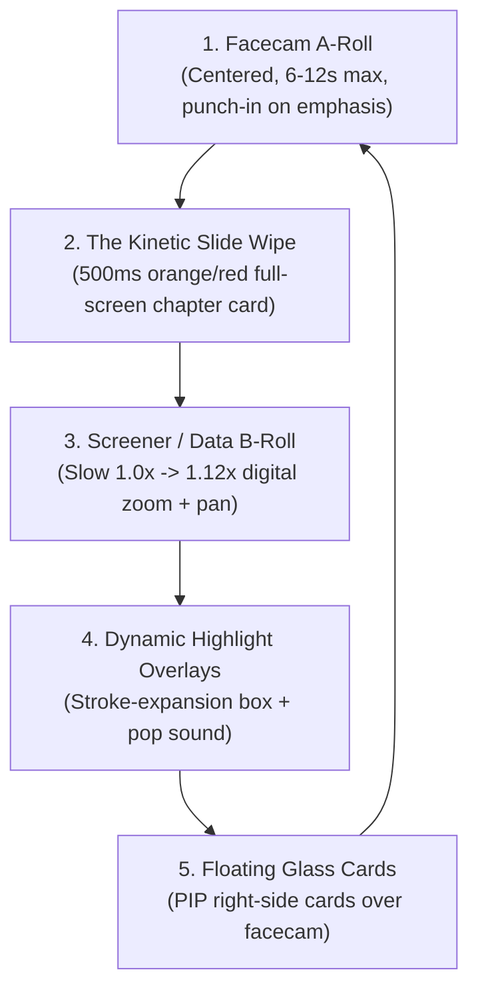

# Forensic Style Decode: Sahil Bhadviya YouTube Production Engine

> **Reference Video:** [`https://youtu.be/vO7u2rM_j1o`](https://youtu.be/vO7u2rM_j1o) (*"Can large cap outperform mid & small cap? Value buy or value trap?"*)  
> **Channel:** Sahil Bhadviya (64,000+ views, 13.75 minutes)  
> **Purpose:** Reverse-engineer every animation, camera motion, Screener/TradingView highlight, section transition, and sound effect to duplicate the exact style for SaN's 8-minute Reliance Jio Mega IPO masterclass.

---

## 1. Executive Forensic Breakdown: The 5 Visual Systems

From frame-by-frame ffmpeg extraction and waveform analysis, Sahil’s video is governed by **5 distinct visual systems**:

---

## 2. Forensic Anatomy of the Motion Graphics

### A. The Section Transition Card (The "Chapter Wipe")
- **Timestamp Proof:** Occurs at `0:59.7` – `1:01.2` (`work/transition_60s_frames/f_019` to `f_031`).
- **Motion Structure:**
  - A vibrant gradient color card (Red `#E8292E` / Orange `#F59614`) slides in from **Left to Right** across the screen.
  - Duration: **500ms (15 frames at 30fps)**.
  - Easing: `cubic-bezier(0.25, 1, 0.5, 1)` (fast entrance, smooth deceleration).
  - Center Content: Bold white typography displaying `CHAPTER [X]: [TITLE]` in uppercase Inter/Montserrat.
  - Exit: As the card clears to the right, the next scene (Facecam or Screener) is already active underneath.
- **Sound Design:** A crisp **Air Whoosh / Paper Slide** SFX peaking at **-12dB**, ending exactly on frame 15.

### B. Screener.in & TradingView Overlays (Dynamic, NOT Static)
- **Timestamp Proof:** Analyzed from `1:08` to `1:22` (`work/screener_overlay_frames/s_001` to `s_026`).
- **1. The Digital Push-In (Zero Static Boredom):**
  - Whenever a website (Screener.in or TradingView) is displayed, the camera never sits still.
  - It applies a continuous **slow digital push-in**: `scale: 1.00` $\to$ `scale: 1.10` over 8–10 seconds, with an anchor point centered on the active row.
- **2. The Stroke-Expansion Highlight Box:**
  - When Sahil mentions a specific number (e.g. P/E ratio or EBITDA margin):
    - A rounded rectangle (`border: 3px solid #EF4444` or `#FACC15`, `border-radius: 8px`) appears.
    - Animation: The border draws around the cell using SVG stroke-dashoffset (duration: **250ms**), accompanied by a soft background tint (`rgba(239, 68, 68, 0.12)`).
    - Sound Cue: A subtle **soft UI click / dry keyboard tap** on the exact frame the box finishes drawing.
- **3. Row Switching:**
  - When moving to the next metric, the previous box fades out in 100ms, and the new box immediately expands onto the target row with a second click sound.

### C. Floating Glassmorphism Cards Over Facecam
- **Timestamp Proof:** Observed at `0:32` and `1:04`.
- **Layout:**
  - Creator is positioned in the center or left-third.
  - A dark glass card (`width: 480px`, `background: rgba(17, 24, 39, 0.85)`, `backdrop-filter: blur(12px)`) slides in from the right edge with a gentle spring bounce.
  - Content: Large neon number (e.g., `₹30,213 CR` or `34x PE`) with an icon and 2 bullet points.
  - Duration on screen: 4 to 6 seconds, then slides back out.

### D. Audio & Pacing Invariants
- **Dialogue Track:** Enhanced master vocals kept at **-3dB to 0dB** peak, crisp, intimate, and normalized.
- **Background Music (BGM):** Soft, low-tempo ambient corporate/investing track sitting at **-24dB to -28dB** (never competing with spoken voice).
- **Cut Frequency:** Cut or change the visual state every **5 to 8 seconds**. Never let a talking head shot run longer than 12 seconds without a punch-in (+10% zoom), a card pop, or B-roll switch.

---

## 3. How to Duplicate This Style for SaN's Jio Video (Remotion + CapCut)

We will use a **3-Layer Editing Architecture** in CapCut with Remotion motion graphic layers:

| Layer | Video Track | Content | Purpose |
| :--- | :--- | :--- | :--- |
| **Track 1 (Bottom)** | **Main V1** | SaN Raw Camera Recording (Facecam 4K/1080p) | Master dialogue and authentic facial authority |
| **Track 2 (Middle)** | **Overlay V2** | Screener.in / TradingView B-Roll (1.0x to 1.12x slow zoom) | Replaces facecam during detailed data breakdowns |
| **Track 3 (Top)** | **Overlay V3** | **Remotion Alpha PNG/ProRes Overlays:** • Chapter Slide Wipe Cards (500ms) • Dynamic Red/Yellow Highlight Boxes • Floating Glass Stat Badges • 200 DMA Chart Line Animations | Studio-grade kinetic motion layer with zero render lag |
| **Track 4 (Audio)** | **Audio A1** | Master Dialogue (+3dB, enhanced voice) | Clear vocal clarity |
| **Track 5 (Audio)** | **Audio A2** | Sound Design SFX (Whooshes, Pops, Clicks) | Tied to every visual graphic trigger |
| **Track 6 (Audio)** | **Audio A3** | Ambient Investing BGM (-26dB) | Subconscious engagement |
