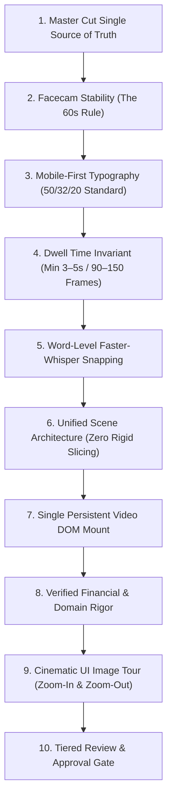
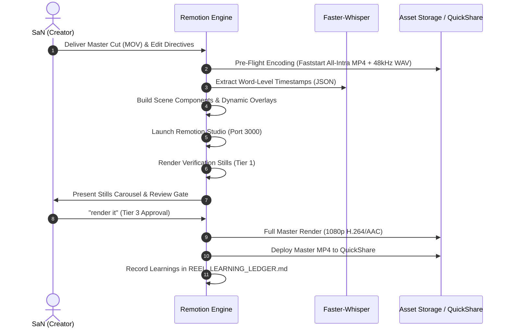

# Pathfinder Video Production SOP & Master Lessons Learned
> **Document Type:** Production Operating Standard & Post-Mortem Engineering Manual  
> **Repository:** `Editor_of_SaN`  
> **Applicability:** All Pathfinder long-form intros, session recordings, and conversion outro videos  
> **Author & Reviewer:** SaN & Antigravity  
> **Version:** 1.0 (Stabilized from October 22, 2026 Production Run)

---

## 1. Executive Summary & Purpose

This document codifies the end-to-end engineering, scripting, motion design, and timing methodology for **Pathfinder** video assets. 

The **Pathfinder series** represents the core analytical engine of the *Happy Investing* ecosystem. Morning live sessions (5:30 AM – 7:00 AM IST) dissect high-conviction structural compounders (e.g., Jio Financial Services, Dixon Technologies, Tube Investments of India). The resulting video requires two critical motion-graphics wrappers:
1. **The Long-Form Intro (~2.0 – 2.5 mins):** Sets expectations, strips fear and greed, frames the 90-minute session as deep forensic education rather than stock tips, and hooks the viewer with a surprise bonus at the end.
2. **The High-Conversion Outro (~2.0 – 2.5 mins):** Bridges the viewer's analytical satisfaction into an immediate, frictionless conversion funnel for the upcoming **Free Live Masterclass**.

This SOP documents every requirement, architectural decision, mistake made, root-cause diagnosis, and permanent correction established during the October 22, 2026 production session. Any AI assistant or video editor must strictly follow this manual for all subsequent Pathfinder edits.

---

## 2. The 10 Non-Negotiable Invariants of Pathfinder Production



### Invariant 1: Master Cut as Single Source of Truth
- **Rule:** Never attempt to slice or sync rough cuts from raw phone camera files (`20261020_*.mp4`).
- **Standard:** Slicing of video and extraction of audio must occur directly on the master rendered file (e.g., `Oct22_Path_Outro.mov`) with identical `-ss` and `-t` parameters.

### Invariant 2: The 60-Second Facecam Side Anchor Rule
- **The Anti-Pattern:** Rapid ping-ponging of SaN’s facecam between Left and Right every 10–15 seconds makes the production look cheap, jittery, and amateurish.
- **The Standard:** Facecam must be locked to a single side for **extended ~60-second blocks**:
  - `0 – 186` (6.2s): Full-Canvas Facecam (Intro hook)
  - `186 – 1914` (~58s steady): Fixed on **Right Side** (`x: 1180, w: 660, h: 940`)
  - `1914 – 3005` (~36s steady): Fixed on **Left Side** (`x: 80, w: 660, h: 940`)
  - `3005 – 4000` (~33s steady): Fixed on **Right Side** (`x: 1180, w: 660, h: 940`)
  - `4000 – 4258` (~9s): **100% Full Canvas Facecam** for the personal sign-off.

### Invariant 3: Mobile-First Typography Standard (The 50/32/20 Rule)
- Over 85% of YouTube and Reel viewers consume content on smartphone screens. Text designed for 1080p desktop monitors is illegible on mobile.
- **Strict Size Hierarchy:**
  - **Main Headlines:** `50px – 56px` (Weight: `900`, Line-Height: `1.15`)
  - **Card Headers & Key Values:** `32px – 36px` (Weight: `800` or `900`)
  - **Category Pills & Badges:** `18px – 24px` (Weight: `900`, Letter-Spacing: `0.1em`, Uppercase)
  - **Descriptive Subtext:** `22px – 26px` (Weight: `600`, Line-Height: `1.4`)
  - **Zero Tolerance:** Never use fonts smaller than `20px` anywhere on screen.

### Invariant 4: Mandatory Dwell Time Invariant (Min 3.0s – 5.0s / 90–150 Frames)
- **The Anti-Pattern:** A graphic element animates in near the end of a spoken sentence, only to be torn down 15–20 frames later when the next scene begins.
- **The Standard:** Every key conceptual graphic, badge, or stat card must remain 100% visible on screen for **at least 75 to 195 frames (2.5 to 6.5 seconds)**. If dialogue triggers late in a clause, the graphic must persist across subsequent pauses and bridge into the next thought.

### Invariant 5: Word-Level Kinetic Snapping via Faster-Whisper
- **The Anti-Pattern:** Eyeballing visual cues or relying on rough sentence timestamps.
- **The Standard:** Audio must be extracted to 48kHz WAV and processed via Faster-Whisper to generate exact word-level frame timestamps (`round(word.start * 30)`). Visuals (button pops, stamps, color changes) must snap precisely to the spoken word syllable.

### Invariant 6: Unified Scene Architecture Over Rigid Time-Slicing
- Do not fragment tightly related thoughts into separate components that unmount abruptly. Combine connected thoughts (e.g., Financial Cost `₹0` + Time Investment `3 Hours` + Calendar Appointment `Sunday 3 PM`) into a **single unified scene component** so prior data points remain anchored while new details illuminate.

### Invariant 7: Single Persistent Video DOM Element
- Exactly **ONE** `<Video>` element must stay mounted across the entire timeline inside `OutroFacecam.tsx`.
- Moving, resizing, and border transformations must be achieved purely through GPU CSS transforms (`translate3d`, `scale`, `border-radius`). Never unmount and remount video tags, which causes decoder black-flashes and audio stutter.

### Invariant 8: Verified Financial Multiples & Domain Rigor
- **Website URL:** Strictly **`www.happy-investing.in`** (Never `.com`, never hyphenated wrongly).
- **Branding Header:** Strictly **`★ HAPPY INVESTING PATHFINDER`**.
- **Price Slash Mathematics:** Regular website masterclass price is **`₹333`**, NOT ₹4,999. The animation must dynamically strike through `~~₹333~~` with a red laser line and explode into **`₹0 (100% FREE BONUS)`**.

### Invariant 9: Cinematic UI Image Tour (Zoom-In & Zoom-Out Architecture)
- When presenting user-interface screenshots (e.g., `Whatsap image.png`), never display a static, shrunk-down graphic.
- Implement keyframed camera navigation:
  1. *Frame 2521 – 2605:* Wide Overview (`scale: 1.0`)
  2. *Frame 2606 – 2656:* Dynamic Pan & Zoom-In to "Member Section" (`scale: 1.48`, `translate(-15%, -10%)`)
  3. *Frame 2657 – 2675:* Smooth Zoom-Out to Reset (`scale: 1.0`)
  4. *Frame 2676 – 2731:* Targeted Pan & Zoom-In to "WhatsApp Button" (`scale: 1.55`, `translate(25%, 15%)`)

### Invariant 10: Pre-Render Local Review & Tiered Approval Gate
- Never run full-length production renders autonomously.
- **Tier 1:** 1-Frame Stills (`remotion still`) on key frames in 2 seconds.
- **Tier 2:** Local real-time review in Remotion Studio (`http://localhost:3000`).
- **Tier 3:** Final master render triggered only upon SaN’s explicit prompt approval.

---

## 3. End-to-End Production Workflow: Step-by-Step



### Phase 1: Pre-Flight Ingestion & Media Engineering
1. **Locate Source Asset:** Ensure master cut is accessible (e.g., `D:\QuickShare\Pathfinder Oc 22nd\Oct22_Path_Outro\Oct22_Path_Outro.mov`).
2. **Faststart All-Intra Facecam Proxy:** Convert raw Long-GOP master to All-Intra (`-g 1`) with faststart flags to enable instantaneous seeking in Chromium/Remotion:
   ```bash
   ffmpeg -y -i "D:\QuickShare\Pathfinder Oc 22nd\Oct22_Path_Outro\Oct22_Path_Outro.mov" \
     -c:v libx264 -preset veryfast -g 1 -keyint_min 1 -crf 20 -movflags +faststart \
     -r 30 -pix_fmt yuv420p -an \
     "pathfinder-oct22-engine\public\video\master_outro_facecam.mp4"
   ```
3. **Uncompressed WAV Audio:**
   ```bash
   ffmpeg -y -i "D:\QuickShare\Pathfinder Oc 22nd\Oct22_Path_Outro\Oct22_Path_Outro.mov" \
     -vn -acodec pcm_s16le -ar 48000 -ac 2 \
     "pathfinder-oct22-engine\public\audio\master_outro.wav"
   ```

### Phase 2: Acoustic Speech Snapping (Faster-Whisper)
1. Run Whisper with word-level timestamps enabled.
2. Export data structure containing `word`, `start` (seconds), `end` (seconds), and calculate frame boundaries:
   $$\text{startFrame} = \text{round}(t_{\text{start}} \times 30.0)$$
   $$\text{endFrame} = \text{round}(t_{\text{end}} \times 30.0)$$
3. Map every conceptual keyword into a speech anchor table before writing Remotion TSX code.

### Phase 3: Remotion Scene Structuring & Dwell Time Safety
1. Define sequence intervals in `src/compositions/PathfinderOct22Outro.tsx`.
2. Ensure that for every animated element inside a scene:
   $$\text{SceneEndFrame} - \text{ElementTriggerFrame} \ge 75 \text{ frames } (\ge 2.5\text{ seconds})$$
3. In `OutroFacecam.tsx`, configure GPU coordinates matching the 60-Second Side Stability Invariant.

### Phase 4: Local Studio Review & Verification Stills
1. Start Remotion Studio daemon:
   ```bash
   npx remotion studio --port=3000
   ```
2. Render Tier 1 verification stills for all milestone frames:
   ```bash
   npx remotion still PathfinderOct22Outro "stills/f792.png" --frame=792
   npx remotion still PathfinderOct22Outro "stills/f1248.png" --frame=1248
   npx remotion still PathfinderOct22Outro "stills/f2110.png" --frame=2110
   ```
3. Generate a Markdown visual preview artifact for SaN’s review.

### Phase 5: Production Master Render & QuickShare Distribution
1. Upon explicit user confirmation, execute master export:
   ```bash
   npx remotion render PathfinderOct22Outro "out/Pathfinder_Oct22_Outro_Master.mp4" --jpeg-quality=95
   ```
2. Mirror the output file directly back to SaN's QuickShare working folder:
   ```powershell
   Copy-Item "pathfinder-oct22-engine\out\Pathfinder_Oct22_Outro_Master.mp4" `
             "D:\QuickShare\Pathfinder Oc 22nd\Oct22_Path_Outro\Pathfinder_Oct22_Outro_Master.mp4"
   ```
3. Run `ffprobe` verification to confirm stream integrity, duration, and audio alignment.
4. Record all metrics and feedback points in `docs/REEL_LEARNING_LEDGER.md`.

---

## 4. Post-Mortem: Mistakes Made & Permanent Architectural Fixes

| # | Mistake Identified During Review | Root Cause in Engine Code | Permanent Engineering Fix |
| :--- | :--- | :--- | :--- |
| **1** | **Price Slash Arithmetic Flaw**<br/>Displayed `~~₹4,999~~ -> ₹0` | Assumed high-ticket course pricing standard instead of checking the actual website store. | Hardcoded regular portal fee to **`₹333`** struck through with red laser line $\to$ explodes into **`₹0 (100% FREE BONUS)`**. |
| **2** | **Wrong Website Domain**<br/>Displayed generic `.com` domain | Hallucinated standard domain suffix without verifying Happy Investing assets. | Strictly locked to **`www.happy-investing.in`** across all scenes, banners, and QR cards. |
| **3** | **Mobile Illegibility (Frames 72 & 1881)**<br/>Text unreadable on phone screens | Developed on high-res desktop canvas using standard web typography (`14px–18px`). | Enforced **Mobile-First 50/32/20 Standard**: Headlines $\ge 52\text{px}$, Cards $\ge 32\text{px}$, Badges $\ge 20\text{px}$. |
| **4** | **Rapid Facecam Ping-Ponging**<br/>SaN switched left/right every 12s | Over-indexed on dynamic visual variety, creating a chaotic "cheap" feel. | Implemented the **60-Second Side Anchor Rule**: SaN stays on Right for 58s, Left for 36s, Right for 33s. |
| **5** | **Missing Custom Image Navigation (Frame 2539)**<br/>Generic CapCut screen recording used | Did not utilize SaN's custom annotated screenshot (`Whatsap image.png`). | Built keyframed dynamic camera tour with zoom-in to Member Section, zoom-out, and zoom-in to WhatsApp arrow. |
| **6** | **Frame 792 Millisecond Cut-Off**<br/>Feature 3 flashed and vanished in 0.5s | Scene 4 was cut at frame 795; Feature 3 entered at frame 775, giving only 20 frames before unmounting. | **Extended Scene 4 boundary to Frame 865.** Feature 3 dwells solidly for **75 frames (~2.5s)** with zero flicker. |
| **7** | **Frame 2110 Millisecond Cut-Off**<br/>"3 HOURS" flashed for 15 frames | Scene 10 faded out between 2099 and 2115 right as "3 hours" popped up at frame 2100. | **Unified Scenes 10 & 11 across Frames 1914–2313.** `₹0`, `3 HOURS`, and Calendar Lock stay together for **195 frames (~6.5s)**. |
| **8** | **Frame 1248 Fleeting QR Code**<br/>QR card was fading out as dialogue peaked | Scene 6 faded out at frame 1256 and unmounted at frame 1270. QR code was only 240px. | **Extended Scene 6 to Frame 1320.** Upgraded to **280px QR code** on white card with radar sweep; dwells for **130 frames (4.3s)**. |
| **9** | **Bonus & Masterclass Sync Mismatch**<br/>Bonus banner faded in Scene 2 before Masterclass appeared in Scene 3 | Bonus banner triggered at 342 and faded at 376 in Scene 2, while Masterclass Pass entered at 485 in Scene 3. | **Created dedicated Masterclass Sequence (Frames 356–630):** Teaser enters @ 356, VIP Pass slams @ 485, dwells for **131 frames (4.4s)**. |
| **10**| **Abrupt Ending Overrun**<br/>Facecam was constrained to cards during sign-off | Final sign-off had split-screen graphics competing with personal eye-contact. | After Frame 4000, SaN expands to **100% Full Canvas Facecam** for a powerful human sign-off. |

---

## 5. Master Timeline & Speech Anchor Reference (Oct 22 Outro)

| Frame Range | Time (s) | Facecam Position | Spoken Anchor Dialogue | Primary Visual Element | Dwell Time |
| :--- | :--- | :--- | :--- | :--- | :--- |
| **0 – 186** | 0.0 – 6.2 | Full Screen (100%) | *"And that marks the end of the video..."* | Top Badge: `★ HAPPY INVESTING PATHFINDER`<br/>Lower-Third: `Session Conclusion & Next Steps` | 186f (6.2s) |
| **186 – 356** | 6.2 – 11.9 | Right Card (35%) | *"like, share, subscribe to this channel..."* | 3 Kinetic Buttons: `👍 LIKE` @ F244, `↗ SHARE` @ F266, `🔔 SUBSCRIBE` @ F278 | 170f (5.7s) |
| **356 – 630** | 11.9 – 21.0 | Right Card (35%) | *"Coming back to the bonus part... is the master class"* | Phase 1: `Exclusive Bonus Reveal` @ F356<br/>Phase 2: `Happy Investing Masterclass VIP Pass` @ F485 | 131f (4.4s) |
| **630 – 865** | 21.0 – 28.8 | Right Card (35%) | *"making the master class live... Q&A... live market psychology"* | 3 Feature Cards: Live Stream @ F655, Direct Q&A @ F728, Psychology Audit @ F780 | 75f (2.5s) |
| **865 – 1100** | 28.8 – 36.7 | Right Card (35%) | *"November 1st is completely free... not even a single rupee"* | Date Card @ F914<br/>Price Slash: `~~₹333~~` $\to$ `₹0 (100% FREE BONUS)` @ F952 | 128f (4.3s) |
| **1100 – 1320**| 36.7 – 44.0 | Right Card (35%) | *"master class is available in both languages... enroll and decide"* | Phase 1: English & Tamil Cards @ F1100<br/>Phase 2: **280px Elite QR Code** + `www.happy-investing.in` @ F1180–1305 | 130f (4.3s) |
| **1320 – 1515**| 44.0 – 50.5 | Right Card (35%) | *"interact with me live... market psychology"* | Pillar 01 Card: `Why Smart Investors Fail in Euphoria` | 175f (5.8s) |
| **1515 – 1720**| 50.5 – 57.3 | Right Card (35%) | *"wealth-building journey... cover from top to bottom"* | Pillar 02 Card: `Institutional Portfolio Framework` | 185f (6.2s) |
| **1720 – 1914**| 57.3 – 63.8 | Right Card (35%) | *"Happy investing community... there will be no push"* | Pillar 03 Card: `No Push. No Tips. Pure Value.` (Cards @ F1762 & F1874) | 174f (5.8s) |
| **1914 – 2313**| 63.8 – 77.1 | **Left Card (35%)** | *"cost of zero... three hours with me on November 1st Sunday 3 pm"* | **Unified Value Exchange:**<br/>`₹0 COST` @ F2045 + `3 HOURS` @ F2100 + `Sunday Nov 1st @ 3 PM` @ F2141 | **195f (6.5s)** |
| **2313 – 2521**| 77.1 – 84.0 | Left Card (35%) | *"If you are really interested... how do we connect with Santosh?"* | Inquiry Card: `How Do You Secure Your Seat?` | 188f (6.3s) |
| **2521 – 2731**| 84.0 – 91.0 | Left Card (35%) | *"sign up for website... member section... connect in whatsapp"* | **Cinematic Camera Tour on `Whatsap image.png`:**<br/>Zoom-In to Member Section @ F2606 $\to$ Zoom-In to WhatsApp Arrow @ F2676 | 210f (7.0s) |
| **2731 – 3005**| 91.0 – 100.2| Left Card (35%) | *"directly ping me... add you to the group for next cohort"* | WhatsApp Registration Card: `Official Cohort WhatsApp Channel` | 254f (8.5s) |
| **3005 – 3305**| 100.2 – 110.2| **Right Card (35%)**| *"no cost to explore the opportunity... decide with all facts"* | Assurance Card: `Zero Cost • 100% Unbiased Fact Sheet` | 280f (9.3s) |
| **3305 – 3636**| 110.2 – 121.2| Right Card (35%) | *"already you have proof of what we are doing in this 1.5 hr session"* | Case Study Proof Cards: `Jio Finance • Dixon Tech • TII India` | 311f (10.4s)|
| **3636 – 4000**| 121.2 – 133.3| Right Card (35%) | *"knowledge is not only reason... action, discipline, practice"* | Compounding Equation Card: `Knowledge + Action + Discipline + Practice` | 344f (11.5s)|
| **4000 – 4258**| 133.3 – 141.9| **Full Screen (100%)**| *"Thanks for your time... See you in the masterclass. Happy investing!"*| **100% Full Canvas Facecam** + Floating Gold Ribbon Signoff | 258f (8.6s) |

---

## 6. Full Spoken Master Transcripts (Clean Teleprompter)

### A. Pathfinder Oct 22 — Intro Transcript (145.34s)
```text
One more time I am doing this. I am going to share the Pathfinder session which we had today from morning 5:30 to 7 o'clock. I really enjoyed this session. There were so many quality questions about Jio Finance, TII India, and Dixon, and many more stocks. 

But the point what I am trying to share here is not the stock tips, but how we have taken that analysis and how, as a team, as a community, we do the analysis is what I wanted to bring to your notice so that you can have the opportunity to evaluate the community. 

I always prefer this community for the beginner and intermediate person because I was struggling for 6 years. I don't want anyone else to again struggle for a few more years when you can take genuine help from this community. But to evaluate, I also know that you need some evidences, proofs that you might be actually taking seriously to evaluate this. If you are finding value in the channel, the strategies, or the analysis we are doing, this is again one more bonus for you. 

If you are new to this channel, I am Santosh. I run a community called Happy Investing with SaN, where I teach people whatever I have learnt in the last 6 years, which has helped me to take the stock market as a serious career path, and also I enjoy teaching people. I spent 6 years to get the knowledge what actually has taken me here, where I actually manage my portfolio of around 70 to 75 lakhs and also my family portfolio. Put together, like 1.5 crores of portfolio I manage for me and my family, and I also help people to get a different perspective of the stock market, where people actually come, learn, and be happy with their learning. And there are 55 people in our community, which is a very close community, and a few more quality people are getting added month by month. 

With that said, let us get into the video. This session is going to be a one-and-a-half-hour session. I know most of you will not make it, definitely. But if you still try to make it, you will gain knowledge—not to pick the stock for tomorrow or this week, but how to approach this is what you are going to learn. If that is your goal, to learn the stock market over the years, over the months, in a long-term perspective, then this video is going to really help you. 

As I said earlier, most of you will not make it through the one and a half hour, I know, because everybody needs quick cash, quick money, and fast growth. That's not easily possible. But if you are a serious learner, I have some bonus for you at the end of the video. See you then.
```

### B. Pathfinder Oct 22 — Outro Transcript (141.95s)
```text
And that marks the end of the video. Hope you enjoyed the video. If you really enjoyed and found value, I request you to consider like, share, and subscribe to this channel to get more value about this. 

Coming back to the bonus part, which I mentioned in the introduction of this session, is the masterclass. Some of you, I know, the masterclass is already available on the website. No, this bonus is about making the masterclass live, with Q&A if needed. 

And the most important thing is, this masterclass, which is going to happen live on November 1st, is completely free. Yes, on the website, already the masterclass is available in both languages. If you are really interested and don't want to wait till November 1st, you can go and enroll into the masterclass, see, and decide yourself. 

But for the people who want to interact with me live on the masterclass, where I will explain the market psychology, where I will explain why I am doing this and why you have to take on this wealth-building journey, I will completely cover from top to bottom and give you a perspective of what this Happy Investing community thinks, and I will give you an opportunity. There will be no push from my side. 

But the masterclass is going to help you to understand at a cost of zero. Just you have to spend three hours with me on November 1st, Sunday at 3:00 PM. That is going to have the opportunity of changing your wealth-building journey. 

If you are really interested to attend the masterclass—how do you actually connect with me, Santosh? Yeah, you have an opportunity to connect with me: just sign up on the Happy Investing website, you will see the Member Section. In the Member Section, connect with Santosh on WhatsApp. You can directly ping me and register your interest so that I will actually add you to the group where the next cohort is going to happen. 

At the end, what I will say is, there is no cost to explore the opportunity. To decide, yes, you take it with all the facts that are going to be presented in the session, that are going to be presented in the masterclass. And already you have the proof of what we are doing in the community in this one-and-a-half-hour session. And already you have seen some of the videos. I assume that you have seen some of the videos. If you have not watched the videos, please go and watch. You have plenty of knowledge sitting on YouTube for free for you. 

But knowledge is not the only reason that you get the benefit. It's your action, it's your discipline, it's your practice. To do that, you need a community. For that, Happy Investing is there for you. 

And that's it from my side. Thanks for your time. Thanks for your patience. See you in the masterclass. Happy investing!
```

---

## 7. Reusable Verification Checklist for Future Pathfinder Edits

Before presenting any new Pathfinder edit for review or rendering, the editor or AI must check off every box:

- [ ] **Master Cut Sourced:** Audio and video extracted directly from master cut (`-g 1 -keyint_min 1 -movflags +faststart` proxy created).
- [ ] **Whisper Timestamps Quantized:** Exact word frame numbers generated via Faster-Whisper.
- [ ] **Branding Verified:** Contains `★ HAPPY INVESTING PATHFINDER` (no spelling mistakes).
- [ ] **Domain & QR Verified:** URL is strictly `www.happy-investing.in` with prominent $\ge 260\text{px}$ scannable QR code.
- [ ] **Price Slash Arithmetic:** Regular fee is `~~₹333~~` struck through $\to$ explodes into `₹0 (100% Free)`.
- [ ] **Mobile Typography Check:** Main headlines $\ge 50\text{px}$, cards $\ge 32\text{px}$, badges $\ge 20\text{px}$. Zero text $<20\text{px}$.
- [ ] **60-Second Side Stability Check:** Facecam stays on one side for extended $\sim 60\text{s}$ blocks (no ping-ponging).
- [ ] **Dwell Time Safety Audit:** Every graphic element stays visible for at least $75\text{ frames} (\ge 2.5\text{s})$; zero millisecond flickers.
- [ ] **Persistent Video Mount:** Facecam uses a single mounted `<Video>` element with GPU CSS transforms.
- [ ] **Full Facecam Finale:** Video transitions to 100% Full Canvas Facecam for the final sign-off.
- [ ] **Tier 1 Stills Inspected:** Stills rendered and verified at key speech timestamps before notifying user.
- [ ] **User Consent Gate:** Full render initiated ONLY after explicit user confirmation (`"render it"`).
