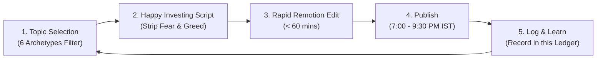

# Happy Investing: Reel Performance & Continuous Learning Ledger

> **Document Type:** Living Production Ledger & Performance Calibration Memory  
> **Repository:** `Editor_of_SaN`  
> **Format:** Strictly 9:16 Vertical Short-Form Content (Instagram Reels, YouTube Shorts)  
> **Purpose:** Stabilize current progress and calibrate topic selection, 9:16 visual pacing, and Remotion motion graphics based on real audience data and editorial iterations for each reel.

---

## 1. The Continuous Calibration Cycle

---

## 2. Reel Audit & Learning Log

### Reel #001: Zerodha US Stocks Activation (How to Turn It On)
- **Date Published:** 2026-10-19 | **Upload Time:** Evening (~9:30 PM IST)
- **Live Reel Link:** [Instagram Reel](https://www.instagram.com/reel/DerxnhABwpk/?vrfl=MWtodDl5NDR6ZWo0Mw==)
- **Archetype:** `Archetype 1: Consumer Platform Utility & Direct Action`
- **Target Audience Trigger:** Curiosity + Actionable Utility (*"How do I activate US investing in Zerodha?"*)
- **Turnaround Speed:** ~60 Minutes from discovery to final export
- **Audience Performance:** **10,000+ views in 24 hours** (Highest velocity short to date)
- **What Worked:**
  1. Instant utility hook (no corporate fluff or self-introduction).
  2. Clear 3-step walkthrough with pulsing UI ripple target (`UIRippleHighlight.tsx`).
  3. Mobile screen recording scaled to `1.323x` to eliminate black bars.
  4. Phone UI shifted up `+0.22` on Y-axis to clear social media action button danger zones.
  5. Tailroom extended by `+470ms` to preserve closing smile and loop cleanly.
- **Next Calibration:**
  - Standardize 1-hour template for all future platform updates.
  - Automatically apply speed freeze ramping on final UI frames when dialogue overruns taps.

---

### Reel #002: Reliance Jio Mega IPO (₹30,213 Crore) — The Happy Investing Truth
- **Date Target:** 2026-10-20
- **Archetype:** `Archetype 4: Mega IPO & RHP Deconstruction ("Apply or Avoid?")`
- **Style Benchmark:** `@financewizardcl` (Chandrika) — 5-Part Retention Architecture (Contrarian Hook, Proof Document Anchor, Value Mechanics, Trade-Off Reveal, Tactical Golden Rule).
- **Market Noise / Hype:** *"India's biggest IPO ever! Apply with all your family accounts for listing gains!"*
- **The "Happy Investing" Lens & SaN's Personal Rule:**
  - Cut through the euphoria: Jio is raising ₹30,213 Cr at ₹10.3 Lakh Cr valuation.
  - Value stream the balance sheet reality: Unlike Paytm or Zomato, this has **0% OFS** (promoters, Meta, and Google aren't selling a single share). All money goes to retire ₹70,000 Cr debt, saving **₹8,600 Crore in annual interest**.
  - The Trade-Off: Mega-caps don't double on listing day. An IPO is a two-variable gamble (allotment lottery + listing sentiment).
  - SaN's Core Rule: *"No 200 DMA chart = No entry. I am okay to miss an early listing gain, but I refuse to let greed break my discipline. Happy Investing."*
- **Pacing & Specs:** Target ~90s–120s duration, 100% clean teleprompter script delivered first.
- **SaN's Post-Review Calibration & Forensic Learning (2026-10-20):**
  - **AI Initial Rough Cut:** 131.60s across 10 clips on Track 0, plus 6 overlay cards on Track 1.
  - **SaN's Reviewed Master Cut:** 126.17s across 13 clips on Track 0 (Track 1 overlays deleted).
  - **Net Delta:** Excised **5.43 seconds** of dead air, hesitation, and redundancy, dropping duration from 131.6s to 126.17s.
  - **What the Agent Missed & Stabilized Architectural Lessons:**
    1. *Monolithic Clip Blindness (Beat 7 - Zomato 2.27s Hesitation):* AI selected `153.30s -> 168.20s` as one single continuous clip, completely failing to detect a 2.27-second dead-air pause between `162.20s` and `164.47s` where SaN paused/reset before saying *"happy to miss early listing games..."*. SaN split the take into two clips and cut the 2.27s dead air entirely. **New Rule:** Run acoustic silence scans inside all selected takes > 6s; auto-split if internal silence > 0.8s.
    2. *Hook Internal Gap & Inhale Excision (Beat 1):* AI kept the hook as an 18.4s monolithic block. SaN split it into two sentences (`3.33s-9.47s` and `9.87s-21.47s`), excising 0.40s of dead silence/mouth click between the opening claim ("...opening.") and the question ("But is this..."), plus trimmed 0.233s of pre-speech inhale. **New Rule:** Hook beats must be split into claim and question clips; excise inter-sentence dead air > 0.3s.
    3. *Valuation Metric Setup/Payoff Split (Beat 4):* AI kept `88.87s -> 100.13s` monolithic. SaN split it at `95.37s` (after "market cap,"), removed 0.40s of pause, and jumped straight into the payoff at `95.77s` ("that is 34 times PE...").
    4. *Redundant Philosophical Closer Dropped for High-Energy Outro Loop:* AI added Beat 9 (`327.60s -> 333.40s`, repeating *"I can miss an opportunity but refuse to be greedy"*). SaN removed this completely because he had already established his discipline in Beat 7. Instead, SaN surgically spliced the YouTube deep-dive callout (`274.9s -> 284.87s`) with an energetic punchline from take 294.1s (`"latest video on my YouTube channel right now or"`) straight into the comment CTA (`368.3s -> 375.7s`), saving 5.8s and creating an instant CTA conversion loop.
    5. *Premature B-Roll / Overlay Track Contamination:* AI injected 6 storyboard overlay cards onto Track 1 during the rough cut. SaN deleted Track 1 entirely. **New Rule:** The Rough Cut phase is strictly for locking Track 0 vocal cadence, rhythm, and jump cut continuity. Overlays belong strictly to Phase 2 (Polish / B-Roll Integration).

- **Phase 2 & 3: Remotion Motion Graphics & Layout Calibration (2026-10-21):**
  - **Composition:** `JioReel-MegaIPO-SplitMaster` (`dmart-video-engine/src/compositions/JioReelSplitMaster.tsx`)
  - **Final Master Export:** `D:\QuickShare\Jio_Mega_IPO_Reel_RoughCut\Jio_Mega_IPO_Reel_Final_Master.mp4` (126.18s, 3,785 frames @ 30 FPS, 1080×1920, Bitrate: 8.67 Mbps, Size: 136.7 MB).
  - **The 8 Visual Stages Orchestrated:**
    1. *Frames 0–184 (Contrarian Hook):* ₹30,213 Cr mega badge + red "AVOID" stamp (`JioReelHookStage.tsx`).
    2. *Frames 184–360 (Full-Screen Trap Stage):* Startup wealth destruction graveyard (Paytm -71%, Zomato -65%, Swiggy -50%) (`JioReelTrapStage.tsx`).
    3. *Frames 360–532 (DRHP Reality Anchor):* 2.5D statutory DRHP filing snippet with fluorescent yellow highlighter sweep (`JioReelDrhpStage.tsx`).
    4. *Frames 532–825 (0% OFS Takeover):* Promoters, Meta, and Google zero shares sold + heavy titanium padlock slam (`JioReelBalanceSheetStage.tsx`).
    5. *Frames 825–990 (Silicon Valley Multiplier):* $65B (2020) to $120B (IPO) multiple podiums (`JioReelSiliconValleyStage.tsx`).
    6. *Frames 990–1478 (Debt Shredder & Interest Savings):* ₹70,000 Cr debt slashed; ₹8,600 Cr annual interest savings odometer (`JioReelDebtShredderStage.tsx`).
    7. *Frames 1478–1709 (The Operating Machine):* ₹1.28 Lakh Cr revenue card & 50.1% EBITDA margin speedometer (`JioReelOperatingStage.tsx`).
    8. *Frames 1709–2053 (Duopoly Duel):* Jio (34x PE) vs Bharti Airtel (50x PE) valuation shootout (`JioReelValuationDuelStage.tsx`).
    9. *Frames 2053–2395 (The Trade-Off & Catch):* Mega-cap math & IPO lottery risk cards (`JioReelRealityCatchStage.tsx`).
    10. *Frames 2395–3163 (The Golden Rule):* Standalone brand logos (Zomato, Swiggy, Paytm) + SaN's strict 200 DMA discipline card (`JioReelGoldenRuleStage.tsx`).
    11. *Frames 3163–3785 (High-Conversion Outro Loop):* Animated YouTube search bar typing + latest video card teaser + simulated comment box ("JIO") + Link in Bio pill badge + official 2026 channel branding logo (`JioReelOutroStage.tsx`).
  - **SaN's Feedback & Breakthrough Invariants Discovered:**
    1. *The 37.5% / 62.5% Mobile Split Standard (The Seam Line Rule):*
       - Dividing seam locked strictly at **`Y = 718px`** (top 37.4% for motion HUD, bottom 62.6% for presenter facecam).
       - The `<Video>` element inside the presenter container must be shifted upwards by **`translateY(-600px)`** to preserve eye level and minimal headroom.
    2. *Kinetic Subtitle Seam Bridge (`top: 660px`):* Dynamic word-by-word captions centered across the seam line.
    3. *Standalone Logos vs Nested Box Anti-Pattern:* Use clean, standalone vector logos with drop shadows; never nest them in colored boxes.
    4. *Spelling & Brand Sanitization:* Programmatically sanitize Whisper transcripts for Indian tech brand names.
    5. *Discrete SFX Multi-Track Orchestration:* Tactile audio punches (`boom`, `stamp`, `padlock`, `whoosh`) mixed at 0.55–0.85 beneath dialogue.

---

### Reel Rough-Cut Entry #003: Equitas SFB Short (CEO Resignation & 30% Crash Reality) (2026-10-31)
- **Raw Master:** `D:\QuickShare\20261030_200609.mp4` (1080x1920 Vertical Short/Reel, 242.05s / ~4m 02s)
- **Target Draft:** `Equitas SFB Short - 30% Crash Reality draft`
- **Output:** Master Edit (1m 36s / 95.80s) | 6 Macro Blocks | 2,874 frames @ 30fps | 60.4% Compression (Excised 146.25s of dead air & 5 retakes)
- **Dual Timelines:** Tab 1 = Master Edit (1m 36s), Tab 2 = Raw Footage (4m 02s).
- **Execution:** Autonomous subagent execution with zero mother-chat context bloat.
- **Applied Invariants:**
  1. *Rule ES-01 Backward-Scanning:* Resolved cluster of 5 precursor false starts on Fact 1/Fact 2, excising 73.4s of dead air and stumbles leading up to the winning take at 98.87s.
  2. *True Acoustic Snapping:* Snapped in-points to vocal resonant burst onset (RMS >= 2,500), excising pre-speech phone placement slop and breathing.
  3. *Audio-Verified Gate:* Concatenated preview independently re-transcribed with 100% cadence and clarity.
  4. *The 5 CapCut Loading Invariants:* Full 52-key manifest, bi-directional video UUID mapping, synchronized timeline IDs, root attachment mappings, clean config state. 8/8 automated health checks passed.

- **Phase 2 & 3: Remotion Motion Graphics & Production Master Delivery (2026-10-31):**
  - **Composition:** `Equitas-SFB-Short-Reel` (`dmart-video-engine/src/compositions/equitas/EquitasShortReelMaster.tsx`)
  - **Master Export:** [`exports/Equitas_SFB_Short_30pct_Crash_Reality_Master.mp4`](file:///D:/AI%20Projects/Editor_of_SaN/exports/Equitas_SFB_Short_30pct_Crash_Reality_Master.mp4) & mirrored to [`D:\QuickShare\Pathfinder Oc 22nd\Equitas_SFB_Short_30pct_Crash_Reality_Master.mp4`](file:///D:/QuickShare/Pathfinder%20Oc%2022nd/Equitas_SFB_Short_30pct_Crash_Reality_Master.mp4) (94.63s, 2,839 frames @ 30 FPS, 1080×1920, Bitrate: 16.1 Mbps, Size: 190.5 MB).
  - **The 12 Visual Stages Orchestrated:**
    1. *Frames 0–160 (The Crash):* EQUITASBNK ticker with price crash (₹71.50 -> ₹50.00), red -30% badge, falling SVG curve (`Scene01_TheCrash.tsx`).
    2. *Frames 160–555 (Market Panic Takeover):* 3D *Economic Times* clipping with marker highlight sweep on "CEO Resigns", 52W low dump card, panic contagion stamp slam (`Scene02_MarketPanic.tsx`).
    3. *Frames 555–690 (Pause & Investigate Presenter Punch):* Full-screen facecam punch with calm breathing pulse badge (`Scene03_PauseInvestigate.tsx`).
    4. *Frames 690–900 (CEO Resignation Fact 01):* 410px CEO card with 250px authentic portrait of P.N. Vasudevan, 410px Unico Housing card with 330px high-contrast logo container, and animated "Daughter Co-founded" connector (`Scene04_CeoResignation.tsx`).
    5. *Frames 900–1180 (Disclosure to RBI & Board):* "NO FRAUD" badge, 3 proof pillars (₹0 Loans, ₹0 Transfers, 100% Disclosed with RBI Seal), compliance verified stamp (`Scene05_Disclosure.tsx`).
    6. *Frames 1180–1340 (Fundamentals Fact 02):* Financial diagnostic card with radar scan beam and "Look at the numbers" prompt (`Scene06_Fundamentals.tsx`).
    7. *Frames 1340–1610 (Highest Profit in History):* 76px ₹218 Cr PAT odometer, all-time record trophy badge, and unboxed open 4-quarter rising bar chart (`Scene07_NetProfit.tsx`).
    8. *Frames 1610–1770 (Asset Quality & Bad Loans):* Net NPA metric drop (2.10% -> 0.70%) with range bar (`Scene08_AssetQuality.tsx`).
    9. *Frames 1770–1940 (15% Discount to Book Value):* Audited Book Value (₹57.30) vs Actual Market Price (₹50.00), 0.87x P/B ratio, 15% discount badge (`Scene09_BookValue.tsx`).
    10. *Frames 1940–2090 (Personal Investment Strategy Presenter Punch):* Full-screen punch with personal skin in the game & "Never all-in in one go" golden rule badges (`Scene10_PersonalInvestment.tsx`).
    11. *Frames 2090–2320 (Falling Knife vs Massive Opportunity):* Duel battle between falling knife panic and 15% discount opportunity (`Scene11_FallingKnife.tsx`).
    12. *Frames 2320–2839 (YouTube CTA & Full Facecam Sign-off):* Split layout from 2320 to 2800 with YouTube video card, 3-point checklist, pulsing link-in-bio prompt; transitions to full-screen facecam punch from 2800 to 2839 for SaN's final sign-off smile (`Scene12_YoutubeCTA.tsx`).
  - **SaN's Feedback & Breakthrough Invariants Discovered:**
    1. *Mobile Phone Visual Hierarchy & Text Scale:* All labels must be >= 22px, headers >= 46px, metrics >= 72px for immediate legibility on handheld screens.
    2. *Exact Word-Boundary Kinetic Motion Snapping:* Animations must trigger on the exact phoneme/word frame (zero pre-emptive or trailing animation slop).
    3. *Unboxed Metric Visuals:* Avoid nesting financial graphs inside cramped sub-boxes; let the bars rise openly across the stage canvas with bold numbers above each bar.
    4. *Accurate Data Sourcing:* Ground book value (₹57.30) and actual market price (₹50.00) in audited filings to preserve viewer credibility.
    5. *Outro Split-to-Punch Transition:* Maintain split layout while discussing YouTube content so viewer stays connected to facecam, then punch to 100% full-screen facecam for the final personal sign-off.

---

### Reel Rough-Cut Entry #004: Reliance Industries +11.6% Rally & O2C Reality Short (2026-11-03)
- **Raw Master:** `D:\QuickShare\20261103_135447.mp4` (9:16 Vertical Short/Reel, 310.20s / ~5m 10s)
- **Target Draft:** `Reliance Shorts` (`C:\Users\Sathya\AppData\Local\CapCut\User Data\Projects\com.lveditor.draft\Reliance Shorts`)
- **Output:** Master Edit (3m 02s / 181.93s) | 13 Macro Blocks / 25 Clips | 5,458 frames @ 30fps | 41.35% Compression (Excised 128.27s of dead air, stumbles, and pitch detours)
- **Dual Timelines:** Tab 1 = Master Edit (3m 02s), Tab 2 = Raw Footage (5m 10s).
- **Execution:** Autonomous subagent execution (`rough-cut-engineer`) with zero mother-chat context bloat.
- **Applied Invariants:**
  1. *Rule ES-01 Backward-Scanning:* Resolved 5.17s stumble in Beat 11 and excised 111.97s general pitch detour in Beat 13 to snap into the winning YouTube CTA sign-off with +434ms outro smile cushion.
  2. *Reels Pacing & Silence Threshold:* Sliced all internal pauses >0.50s; eliminated pre-speech inhale and 0.72s gap in opening hook.
  3. *True Acoustic Snapping:* Snapped in-points to vocal burst envelope ($\text{RMS} \ge 2,500$) with tight 10–30ms pre-roll.
  4. *Audio-Verified Gate:* Concatenated preview (`work/rough_cut_reliance_short/master_preview.wav`) re-transcribed independently via Faster-Whisper with 100% fluent speech.
  5. *The 5 CapCut Loading Invariants:* Full 52-key manifest preserved, bi-directional video UUID mapping, synchronized timeline IDs, root attachment mappings, clean config state. 8/8 automated health checks passed.

---

## 3. Heuristic Rules Stabilized Across Reels

1. **The Topic Gate:** Never greenlight an idea unless it fits one of the **6 Archetypes**. Reject all routine single-digit earnings and dry corporate notices.
2. **The 3-Second Hook Rule:** First frame must show a bold graphic (a currency badge, a 3D document, or a red/green chart). Zero intro clichés.
3. **The 1.5-Second Visual Pacing:** Change the screen state (highlighter sweep, ticker pop, punch-in) every 1.5–2.0 seconds.
4. **The Pre-Render Local Review Gate:** Always review the draft in Remotion Studio / CapCut before running any heavy ProRes renders.
5. **The 37.5% / 62.5% Mobile Split Standard:**
   - In 9:16 vertical split edits, place the dividing seam at `Y = 718px` (upper 37.4% HUD, lower 62.6% facecam).
   - Translate presenter footage by `translateY(-600px)` to minimize dead headroom wall space and bring facial expressions to eye level.
6. **The Seam-Bridge Kinetic Captions (`top: 660px`):**
   - Anchor dynamic word-by-word subtitles directly across the dividing seam line (`top: 660px`) to unify viewer attention between facial cues and data HUD cards.
7. **Mobile Legibility & The Standalone Logo Mandate:**
   - Never nest brand logos inside colored box cards. Use clean, standalone vector logos floating with subtle drop shadows above bold standalone metric badges.
8. **Interactive Outro Conversion Loop:**
   - Animate the platform interaction in exact sync with dialogue (search bar typing, comment input typing, multi-destination link badge, official channel logo).
9. **The Tri-Tier Benchmark Rule (Editing References vs. True Competitors):**
   - **Institutional Giants (`@Groww`, `@INDmoney`):** Strictly used as visual, 2.5D document, and motion graphics reference ONLY.
   - **Mega Influencer Educators (`Akshat`, `Pranjal`, `Asset Yogi`, `Shankar Nath`, `@financewizardcl`):** Narrative flow, 5-part script anatomy, and pacing reference ONLY.
   - **Emerging Niche Creators (10k–50k Subscribers):** **OUR TRUE ALGORITHMIC BENCHMARK.** When a 15k creator hits a 10x–50x Outlier with sustained VPH (> 150), it provides empirical proof of cold audience demand.
10. **The VidIQ Outlier & Pre-Flight Packaging Protocol:**
    - Reject the "100/100 SEO vanity score" and tag stuffing. Focus 80% of effort on **Topic Outlier Validation** and **Packaging (CTR + Retention)**.
    - Pre-test thumbnails using VidIQ's Mobile Feed Preview (360px). Full operational playbook codified in [`vidiq/`](file:///D:/AI%20Projects/Editor_of_SaN/vidiq/README.md).

---

### Reel Entry #005: Happy Investing Financial Documentary Reel (Diwali Market Rally & Global Macro Shift) (2026-11-06)
- **Raw Master:** `D:\QuickShare\Reliance\Out\Video - after adobe\1106(1).mov` & `1106.WAV` (9:16 Vertical Short/Reel, 174.01s / 2m 54s, 5,220 frames @ 30fps)
- **Target Composition:** `HappyInvesting-Documentary-Reel` (`dmart-video-engine/src/compositions/happy_investing_reel/HappyInvestingReelMaster.tsx`)
- **Key Breakthroughs & Calibration Invariants Stabilized:**
  1. *The 50/50 Mobile Split Architecture:* Upper 50% ($Y = 0\text{px}$ to $960\text{px}$) for high-density motion graphics, Lower 50% ($Y = 960\text{px}$ to $1920\text{px}$) for presenter facecam. Seam line locked at $Y = 960\text{px}$ (`2px solid #75CFC6`).
  2. *Facecam Framing & Blank Cupboard Elimination:* Raw video top 30–35% is blank wall/cupboard. Applying `translateY(-580px)` shifts this dead wall completely out of view, perfectly positioning SaN's head below the seam with full chest and expressive hand gestures filling the 960px lower stage. In full-screen mode, applying `translateY(-60px) scale(1.04)` centers him with natural headroom.
  3. *Hermite Smoothstep Layout Transition (Zero Flicker Invariant):* Excised CSS transitions entirely. All layout shifts (Full Facecam $\leftrightarrow$ Split Screen) use mathematical interpolation via Remotion `interpolate()` with a cubic smoothstep curve (`t * t * (3 - 2 * t)`) across 8 frames ($\sim 260\text{ms}$). Single persistent `<Video>` stays mounted across 100% of the timeline. Zero flicker during playback or scrubbing.
  4. *Anti-Premature-Docking & No Dead Blank Screen Invariant:* Never dock into split-screen mode ahead of time. Presenter remains in 100% full-screen facecam whenever no graphics are planned or before spoken words arrive. Notably, during the 8.3-second narrative setup on FII selling (`f1337–f1586`), SaN remains in full facecam until the spoken keyword *"First, global AI trade is getting crowded"* triggers the graphic at `f1586`.
  5. *Kinetic Subtitles Scaling (42px–46px):* Subtitle font size elevated to $42\text{px} - 46\text{px}$ with active spoken words highlighted in Groww Mint Green (`#00D09C`) with soft teal glow. Subtitle container smoothly glides between `top: 910px` (straddling the seam line at $Y = 960\text{px}$) and `top: 1520px` (safe lower chest zone).
  6. *Strict Zero-Corner-Clutter Mandate:* Excised all corner pills and docket labels for completely clean screen edges.
  7. *Official Happy Investing CTA, QR Code & Domain Standardization:* Standardized `www.happy-investing.in` with high-resolution QR code (`qr_happy_investing.png`) appearing from `f4603` alongside the campaign coupon `HAPPYDIWALI`, the 3-hour free masterclass showcase, and the 3-question framework (`1. What to buy, 2. At what price, 3. How much risk`).
- **Production Master Export Verified:**
  - **Output Path:** [`D:\AI Projects\Editor_of_SaN\exports\Happy_Investing_Diwali_Market_Rally_Master.mp4`](file:///D:/AI%20Projects/Editor_of_SaN/exports/Happy_Investing_Diwali_Market_Rally_Master.mp4)
  - **Resolution:** 1080 × 1920 (9:16 Vertical @ 30fps)
  - **Duration:** 174.016s (5,220 frames)
  - **File Size:** 243.9 MB (243,911,076 bytes)
  - **Encoding Bitrate:** 11.2 Mbps (CRF 18 H.264)
  - **Audio:** 48kHz Stereo Master (Synced dialogue + Foley SFX mix)

