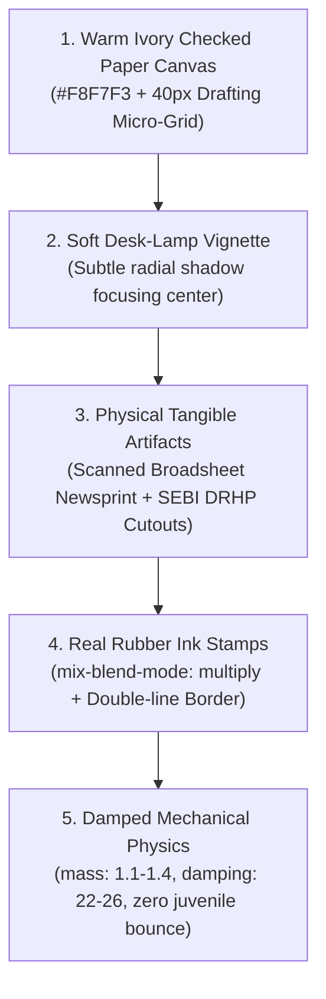

# Think School, Rahul Jain & Sahil Editorial Design System
*Forensic Visual Standard for SaN Masterclasses & Documentary Financial Edits*

---

## 1. Executive Summary & Root Cause Forensic

SaN's critique pinpointed the fundamental flaw in the previous visual direction:
> *"It still looks like website not the premium website that to amateur website... mostly edit looks monotonous with colored text and flashy animation, it doesn't look elite... there is something lacking - that premium look and feel Think School gives in their edit is not there."*

### Why the Previous Look Felt Like an "Amateur Website":
1. **The Dark Mode Fintech Trope:** Using pitch black backgrounds (`#070B12`) with glowing cyan borders (`#00D2FF`) and translucent dark cards (`rgba(11, 15, 25, 0.94)`). This mimics a SaaS crypto trading terminal or web mockup, not an elite investigative masterclass.
2. **Sensory Monotony & Neon Glow:** When everything glows with `box-shadow: 0 0 20px ...`, nothing stands out. Real documents, audited balance sheets, and SEBI filings do not emit neon light.
3. **The Spatial Clipping Disaster (Issue 2):**
   In Clip 01 of the Equitas intro, 4 large elements (`HeadlineBadge` + 48-Hr Card + `StockTickerCard` + `FinancialChart`) were stacked vertically with 32px gaps inside a 980px stage. To attempt to fit them, an arbitrary negative offset (`translate: "4.2px -308.9px"`) was applied. This shoved the top 308px (the entire "EQUITAS SFB CRISIS ALERT" headline) completely off the top of the screen where it clipped and vanished.

---

## 2. The Think School / Rahul Jain / Sahil Editorial Blueprint

### Core Metaphor: The Investigator's Tangible Desk
The canvas is treated as a **physical analytical dossier desk**, not a smartphone UI.

### The 4 Pillars of "Near to Reality" Design:

| Pillar | Amateur Website Look (Banned ❌) | Think School / Rahul Jain Reality (Standard ✅) |
| :--- | :--- | :--- |
| **Canvas** | `#070B12` Pitch Black with neon cyan edges | Warm Ivory `#F8F7F3` with 40px checked drafting grid and major 200px coordinate rules |
| **Lighting** | Digital neon glows (`0 0 20px cyan`) | Ambient desk lighting with soft multi-tier drop shadows (`box-shadow: 0 12px 28px -4px rgba(15,23,42,0.09)`) |
| **Documents** | Dark glass rounded cards (`borderRadius: 20`) | Scanned newsprint (`#FBF9F4`) with authentic broadsheet masthead, double rules, tape tab, and -1.2° physical tilt |
| **Highlighter** | Solid colored rectangle or gradient text | Authentic Stabilo Boss marker sweep (`rgba(254, 240, 138, 0.78)`) with `mix-blend-mode: multiply` so text is legible underneath |
| **Rubber Stamp** | Dark navy pill with glowing red text | Real rubber ink stamp: transparent background, `mix-blend-mode: multiply`, double-line distressed border, heavy downward slam |
| **Typography** | Rainbow colored text (cyan, green, red, gold) | High-contrast Obsidian Ink (`#0F172A`), Slate (`#1E293B`), and Archival Lead (`#64748B`). Zero rainbow gradients |
| **Charts** | Neon glowing curves with thick gradients | Technical coordinate axes, dashed grid, crisp 3.5px solid ink stroke, subtle 0.04 wash, and clean paper callout tag |

---

## 3. Strict 1140×980 Safe Zone Spatial Budgeting (Fixing Issue 2)

### Stage Constraints:
- **Total 16:9 Canvas:** `1920px × 1080px`.
- **Facecam Box:** `580px × 980px` at `top: 50px` (occupies 30–32% real estate).
- **Graphics Stage Box:** `1140px wide × 980px high` at `top: 50px`.
- **Mandatory Safe Margin:** `40px` on all sides.
- **Max Usable Graphics Safe Zone:** **1060px wide × 860px high**.

### The Vertical Budget Rule (Sum ≤ 860px):
Every scene inside the Graphics Stage must allocate its height across three distinct zones:

$$\text{Total Height} = H_{\text{header}} + H_{\text{metric}} + H_{\text{content}} + \sum \text{Gaps} \le 860\text{px}$$

* **Tier 1 (Header Zone):** Max **110px** (`EditorialHeadlineBadge`).
* **Tier 2 (Metric Zone):** Max **140px** (`EditorialStatCard`).
* **Tier 3 (Content/Evidence Zone):** Max **400px** (`EditorialChart`, `PhysicalClipping`, or Comparison Duel).
* **Inter-element Gaps:** $2 \times 20\text{px} = 40\text{px}$.
* **Calculated Total:** $110 + 140 + 400 + 40 = \mathbf{690\text{px}}$ (leaving **170px of clean breathing headroom**).

> [!CAUTION]
> **Zero Arbitrary Negative Offsets:**
> Never apply inline negative translates (e.g. `translate: "4.2px -308.9px"`) to parent `<Sequence>` containers.
> When comparing two entities (e.g. Day 1 vs Day 2, or Paytm vs Jio), use a **2-Column Horizontal Split** (`gridTemplateColumns: 1fr 1fr`) instead of vertical stacking.

---

## 4. Production Components Implemented

The following modular components are now codified and exported from `dmart-video-engine/src/motion-kit/`:

1. **`EDITORIAL_TOKENS` (`src/motion-kit/theme/editorialTokens.ts`):**
   - Ivory paper canvases (`#F8F7F3`, `#F3EFE6`).
   - Deep obsidian ink (`#0F172A`, `#1E293B`).
   - Institutional accents (Carmine Crimson `#B91C1C`, Forest Emerald `#15803D`, Antique Brass `#B45309`).
   - Multi-layer physical desk drop shadows.
   - Damped physical springs (`mass: 1.1`, `damping: 22`, `stiffness: 95`).

2. **`EditorialCanvas.tsx` (`src/motion-kit/modules/EditorialCanvas.tsx`):**
   - Architectural 40px checked grid with 200px major coordinates.
   - Micro `+` registration crosshairs at grid intersections.
   - SVG paper fiber noise texture with `mixBlendMode: multiply`.
   - Soft desk-lamp radial vignette.
   - Technical docket header and footer metadata.
   - Built-in `1060px × 860px` safe zone container.

3. **`PhysicalClipping.tsx` (`src/motion-kit/modules/PhysicalClipping.tsx`):**
   - Scanned broadsheet newsprint (`#FBF9F4`) with authentic masthead (The Economic Times, Financial Express, Mint).
   - Publication date, edition metadata, double rule lines.
   - Realistic Stabilo Boss marker sweep with `mix-blend-mode: multiply`.
   - Physical desk drop shadow and -1.2° organic tilt.

4. **`PhysicalStamp.tsx` (`src/motion-kit/modules/PhysicalStamp.tsx`):**
   - Authentic liquid ink pressed onto paper with transparent background and `mix-blend-mode: multiply`.
   - Double-line distressed rubber stamp border.
   - Heavy physical downward slam physics (`scale: 2.2 -> 1.0` with micro-rebound).
   - Natural human stamping angle (`-8deg` or `+6deg`).

5. **`EditorialStatCard.tsx` (`src/motion-kit/modules/EditorialStatCard.tsx`):**
   - Crisp bond paper card surface (`#FFFFFF`) with subtle border.
   - Charcoal labels, monospaced numbers, and smooth mathematical counter easing.
   - Subdued institutional tint badge (zero neon gradients).

6. **`EditorialChart.tsx` (`src/motion-kit/modules/EditorialChart.tsx`):**
   - Clean coordinate axes, dashed grid, and crisp 3.5px solid ink stroke.
   - Subtle 0.04 wash (zero neon blur).
   - Integrated 200 DMA benchmark line and active tip node callout tag.

---

## 5. Visual Proof & Render Verification

The showcase composition `Equitas-SFB-Editorial-Showcase` was registered in `Root.tsx` and validated:
- **Clip 01 (Frame 100):** Rendered to `work/editorial_clip01_frame100.png` (633 KB).
- **Clip 02 (Frame 800):** Rendered to `work/editorial_clip02_frame800.png` (1.18 MB).
- **TypeScript Check:** `tsc --noEmit` exited with **Code 0** (zero compilation errors).
