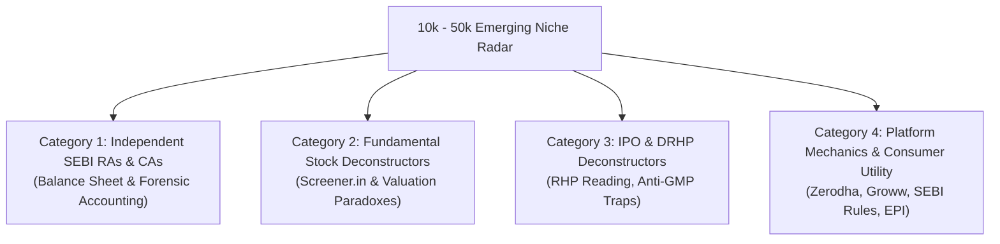

# Emerging Niche Creators Watchlist (10k–50k Tier)
**Channel:** *Happy Investing*  
**Core Directive:** Do not benchmark view counts against mega-influencers or institutional apps. Benchmark algorithmic breakout potential against **emerging creators (10,000 to 50,000 subscribers)** who win purely on topic appeal, packaging, and viewer retention.

---

## 1. Why the 10k–50k Tier is Our Primary Intelligence Asset

| Creator Tier | Typical Subscriber Base | View Distortion Factor | Why They Mislead as Competitors |
| :--- | :--- | :--- | :--- |
| **Institutional Giants** (`Groww`, `INDmoney`) | Millions of app users | **Massive Corporate Distortion:** Multi-crore ad budgets, app notification pushes, paid distribution. | **NEVER use as competitors.** Use strictly for **motion graphics, 2.5D visual cards, and kinetic B-roll reference**. |
| **Mega Influencers** (`Akshat`, `Pranjal`, `Asset Yogi`, `Shankar Nath`) | 1M to 5M+ subscribers | **Subscriber Loyalty Distortion:** Viewers watch because of personality and established trust over 5+ years. | **NEVER use as competitors.** Use strictly for **storytelling flow, pacing, and 5-part hook anatomy reference**. |
| **Emerging Niche Creators** | **10,000 to 50,000 subscribers** | **ZERO DISTORTION (Pure Algorithmic Merit):** No paid ads, no brand inertia, minimal subscriber buffer. | **OUR TRUE COMPETITIVE RADAR.** When they hit 100k+ views (a 10x Outlier), it is 100% proof that cold viewers and the algorithm demanded that topic. |

---

## 2. The 4 Micro-Niche Creator Archetypes to Monitor in VidIQ

When setting up our **Competitors Tab** in VidIQ, we populate it with 10–15 channels belonging to these 4 micro-niches:

### Category 1: Independent SEBI RAs & Chartered Accountants
* **Focus:** Forensic accounting, hidden debt, audit qualifications, tax restructuring.
* **What to watch for:** When an independent CA posts a video exposing why a company’s operating cash flow doesn't match its reported accounting profit, and it hits 50k+ views on a 15k channel $\to$ **Immediate candidate for our Valuation Paradox Archetype**.

### Category 2: Fundamental Stock Deconstructors
* **Focus:** Screener.in balance sheet breakdowns, 10-year median PE analysis, capital allocation.
* **What to watch for:** Outlier videos comparing high ROE stocks currently trading at cyclical low PEs (e.g., *"Why D-Mart or Colgate dropped despite strong business metrics"*).

### Category 3: IPO & DRHP Deconstructors
* **Focus:** Reading official 400-page regulatory filings, analyzing Offer-for-Sale (OFS) cash-outs vs. Fresh Issue proceeds.
* **What to watch for:** Unbiased teardowns of mega IPOs that reveal promoter sell-offs or valuation excesses.

### Category 4: Platform Mechanics & Consumer Utility
* **Focus:** Direct mutual funds, Zerodha Kite hacks, Groww features, CDSL demat safeguards, SEBI circular execution.
* **What to watch for:** Practical how-to videos that solve friction points (e.g. how early pay-in works, how to avoid transaction charges).

---

## 3. How to Find & Add Emerging Niche Channels in VidIQ

1. **Use VidIQ's Keyword Inspector:**
   - Search our core keywords: `SEBI circular`, `stock market balance sheet`, `DRHP breakdown`, `mutual fund taxation`.
   - In the search results, look at the **"Channel"** column.
   - Ignore channels with $> 250,000$ subscribers.
   - Pinpoint channels with **between 10,000 and 50,000 subscribers** whose video view count significantly exceeds their subscriber count.
2. **Add to VidIQ Competitors:**
   - Click the VidIQ extension icon next to the channel name $\to$ **"Add as Competitor"**.
   - Keep the competitor dashboard populated with 10–15 active emerging creators.
3. **The 60-Day Channel Rotation Protocol:**
   - Review the Competitors Tab every 60 days.
   - If an emerging creator has stopped uploading, or if their views drop to single-digit baselines, remove them.
   - Replace them with fresh emerging creators who are generating new breakout hits in Indian finance.

---

## 4. The Outlier Trigger Checklist

Whenever VidIQ flags a video from our emerging creator watchlist:

- [ ] **Subscriber Check:** Is the creator between 10k and 50k subscribers?
- [ ] **Multiplier Check:** Is the video's view count at least **5x to 10x** the channel's recent median views?
- [ ] **Velocity Check:** Is the video still pulling **$> 100\text{ VPH}$** in the past 7–14 days?
- [ ] **The 6 Archetypes Test:** Does this topic fit one of our 6 qualified archetypes (*Platform Utility, Drawdown Panic, Valuation Paradox, Mega IPO, Regulatory Shock, Smart Money*)?
- [ ] **The Happy Investing Test:** Can we present this with audited balance-sheet truth, stripping fear and greed, elevated by our professional Remotion motion graphics?

If all 5 boxes are checked $\to$ **Greenlight immediately for scripting and production.**
