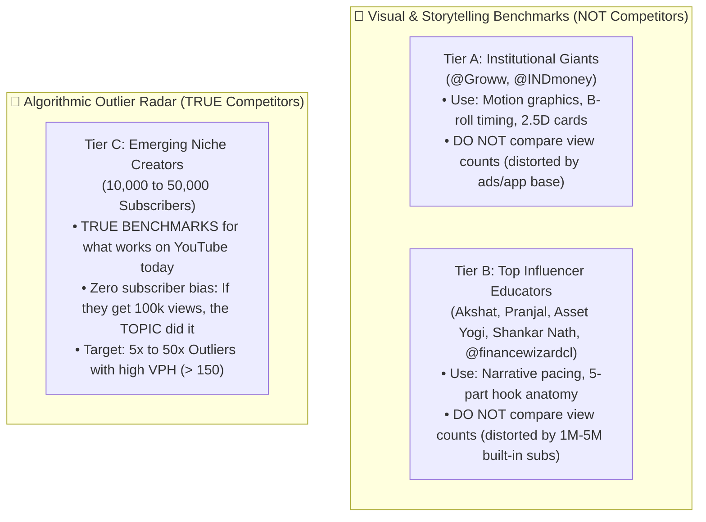

# VidIQ Growth Intelligence & Channel Scaling Engine
**Channel:** *Happy Investing* | **Repository:** `Editor_of_SaN`  
**Purpose:** Systematize algorithmic topic discovery, outlier mining, and packaging optimization to scale our audience without falling into vanity metrics or generic corporate noise.

---

## 🌟 The Benchmark Architecture: References vs. True Competitors

The most critical strategic rule established for *Happy Investing* is the strict separation between **Editing References** and **Algorithmic Competitors**:

### 1. Tier A: Institutional Giants (`@Groww`, `@INDmoney`)
* **Role:** **Shorts Editing & Motion Graphics Reference ONLY.**
* **Why they are NOT competitors:** Their views are heavily subsidized by multimillion-dollar marketing budgets, native in-app push notifications, and corporate media teams. Comparing our view metrics against them yields zero useful algorithmic insight.
* **What we extract from them:**
  - Fast-paced 2.5D document perspectives and yellow marker highlighters.
  - Split-screen valuation shootouts and comparison duel layouts.
  - 60-second micro-storytelling pacing.

### 2. Tier B: Top Influencer Educators (`Akshat`, `Pranjal`, `Asset Yogi`, `Shankar Nath`, `@financewizardcl`)
* **Role:** **Scripting, Hook Architecture & Explainer Flow Reference ONLY.**
* **Why they are NOT competitors:** When a creator with 2M–5M subscribers gets 300k views, it is largely driven by **subscriber loyalty and brand inertia**. A new or growing channel trying to copy their broad, personality-driven videos will fail because the algorithm will not push personality content from unknown creators.
* **What we extract from them:**
  - `@financewizardcl` (Chandrika): 5-part script anatomy (Contrarian Hook $\to$ Proof Anchor $\to$ Mechanic Breakdown $\to$ Trade-Off Reveal $\to$ Tactical Golden Rule).
  - High-retention narrative transitions and curiosity loops.

### 3. Tier C: Emerging Niche Creators (10k–50k Subscribers) — **OUR TRUE BENCHMARK**
* **Role:** **The Algorithmic Truth Radar.**
* **Why this is our ONLY true competitor pool in VidIQ:**
  - Creators in this bracket have **zero brand inertia** and **zero paid ad budget**.
  - When a creator with 15k subscribers publishes a video that hits **150,000 views (a 10x Outlier)**, YouTube’s recommendation engine pushed it to cold audiences solely because the **Topic, Angle, and Packaging** were irresistible.
  - Studying their high-VPH breakout hits reveals the exact queries, frustrations, and curiosities retail investors are clicking on *right now*.

---

## 📂 Documentation Directory

1. [`VIDIQ_GROWTH_PLAYBOOK.md`](file:///D:/AI%20Projects/Editor_of_SaN/vidiq/VIDIQ_GROWTH_PLAYBOOK.md)  
   *The complete masterclass on VidIQ features, the Outlier Multiplier, Views Per Hour (VPH) dynamics, Search vs. Browse mechanics, and the 5 fatal traps to avoid.*

2. [`EMERGING_CREATORS_WATCHLIST.md`](file:///D:/AI%20Projects/Editor_of_SaN/vidiq/EMERGING_CREATORS_WATCHLIST.md)  
   *The curated directory of 10k–50k subscriber Indian financial creators, micro-niche categories, and our 60-day rotation methodology.*

3. [`WORKFLOW_INTEGRATION.md`](file:///D:/AI%20Projects/Editor_of_SaN/vidiq/WORKFLOW_INTEGRATION.md)  
   *The end-to-end SOP connecting VidIQ outlier discovery $\to$ 6 Archetypes Filter $\to$ Clean Teleprompter Script $\to$ Remotion Motion Kit $\to$ Publication.*
