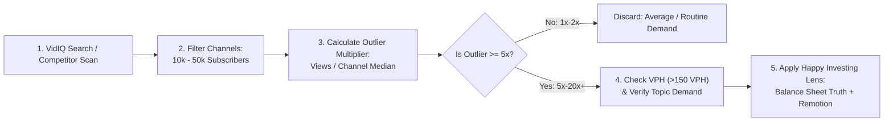

# VidIQ Growth Playbook: The Algorithmic Scaling Manual
**Channel:** *Happy Investing*  
**Knowledge Base:** Synthesis of VidIQ Official 2026 Masterclass, Robert Benjamin (40M+ Views), Film Booth Outlier Methodology, Think Media & Channel Makers.

---

## 1. The Outlier Detection Framework



### The Outlier Multiplier Formula
$$\text{Outlier Multiplier} = \frac{\text{Specific Video Views}}{\text{Channel Median Views (Last 15 Uploads)}}$$

* **1x – 2x:** Average performance. Niche interest only; does not break into suggested/browse.
* **3x – 5x:** Strong topic momentum. Worth evaluating if it fits our 6 Archetypes.
* **10x – 50x+:** **Algorithmic Goldmine.** YouTube’s recommendation algorithm is aggressively promoting this video to cold, non-subscribed audiences. The topic and packaging have solved a universal point of friction.

### Why Small-Channel Outliers Matter
* Large channels (1M+ subs) generate views through **subscriber notifications and homepage defaults**. Even a mediocre video gets 50k views.
* Small channels (10k–50k subs) get **zero algorithmic charity**. If a video explodes on a small channel, **the market demand for that idea is undeniable**.

---

## 2. Views Per Hour (VPH) & The "Popular Tab" Trap

### The Trap:
Visiting a competitor channel and clicking **"Popular"** causes creators to recreate 2-to-5-year-old videos whose algorithmic momentum and market conditions are long dead.

### The Pro Standard:
1. Open the **VidIQ Competitors Tab**.
2. Filter uploads to **"This Month"** or **"Past 7–14 Days"**.
3. Sort directly by **VPH (Views Per Hour)**.
4. **Velocity Benchmarks:**
   - **$> 100 - 300\text{ VPH}$ on a 10k–50k channel:** Active viral breakout.
   - **$> 1,000+\text{ VPH}$ on any channel:** High-velocity market catalyst.
   - **The Evergreen Magnet Test:** If a video published 6–12 months ago still sustains $\ge 50 - 100\text{ VPH}$, it represents a permanent structural search query in Indian finance (e.g., *"How to check CIBIL score accurately"*, *"NPS vs Mutual Funds for Tax Saving"*).

---

## 3. Keyword Research: The "Search vs. Browse" Matrix

VidIQ provides two critical metrics for every keyword: **Search Volume** (monthly demand) and **Competition Score** (how saturated the term is).

```
        High Search Volume (> 100k)
               ▲
               │  [ZONE 2: The Red Ocean]         │  [ZONE 1: The Golden Sweet Spot] ⭐
               │  High Search + High Comp         │  High Search + Low/Med Comp
               │  e.g. "Stock Market India"       │  e.g. "Zerodha US Stocks Activation"
               │  e.g. "Best Stocks to Buy"       │  e.g. "SEBI New Margin Rule 2026"
               │  Result: Drowned out by giants   │  Result: High ranking odds & instant CTR
───────────────┼──────────────────────────────────┼────────────────────────────────────────►
               │  [ZONE 4: The Dead Zone] ❌      │  [ZONE 3: The Long-Tail Foundation]
               │  Low Search + High Comp          │  Low Search + Low Comp
               │  e.g. "PGHH Q2 EPS 2026"         │  e.g. "How to read DRHP balance sheet"
               │  Result: Boring corporate noise  │  Result: Evergreen compounding views
               │
               ▼
        Low Search Volume (< 5k)
```

### The Phrasing Multiplier
Slight wording adjustments yield 5x to 10x swings in viewer intent and search volume:
* **Boring/Routine:** *"Havells India Q2 Results Breakdown"* $\to$ 2,500 monthly searches (High competition from news bots).
* **High-Intent Outlier:** *"Havells Revenue Up 35%, Why Did Stock Drop 6%?"* $\to$ 45,000 monthly searches (Curiosity + Loss Aversion).

---

## 4. Packaging Architecture: Pre-Flight Thumbnail & Title Testing

YouTube's algorithm does not judge your video by how much you love it; it judges your video by **how many people click when shown an impression (CTR)** and **how long they stay (AVD)**.

### A. The VidIQ In-Browser Thumbnail Preview (Mandatory Pre-Flight)
Before rendering the final video or uploading to YouTube:
1. Open VidIQ's **Thumbnail Preview Tool**.
2. Select **Mobile Viewport (360px width)** and **YouTube Dark Mode**.
3. Place your proposed thumbnail side-by-side with the top 5 competing thumbnails in the search results.
4. **The 3 Audit Questions:**
   - *Contrast Check:* If all competitors use white or bright blue thumbnails, does our dark charcoal `#0D1117` + gold amber `#F59E0B` palette visually dominate the feed?
   - *The 0.5-Second Text Rule:* Can a mobile user scrolling with their thumb read the main visual cue (e.g. `"TRAP"`, `"-10%"`, `"0% OFS"`) in under 0.5 seconds?
   - *Zero Redundancy:* Does the thumbnail text merely repeat the title? (Fail). The title should present the question/claim; the thumbnail should provide the visual proof/stakes.

### B. Title Formulations for Native A/B Testing
Prepare 3 distinct title angles for every video using VidIQ's multi-title testing tool:
1. **The Contrarian Hook:** *"Why Institutions Are Dumping [Stock] Despite Record Profits..."*
2. **The Decision / Verdict Hook:** *"[Stock] Crashed [X]%: Golden Opportunity or Deadly Trap?"*
3. **The Balance Sheet Audit Hook:** *"Reading the Balance Sheet of [Company]: What Retail Missed."*

---

## 5. The 5 Fatal Mistakes Creators Make With VidIQ

| Mistake | What Amateurs Do | What the YouTube Algorithm Actually Does |
| :--- | :--- | :--- |
| **1. The 100/100 SEO Delusion** | Spending 45 minutes tweaking tags and descriptions until VidIQ shows green (100). | VidIQ's SEO score is an internal checklist, not YouTube's algorithm. YouTube prioritizes **Viewer Retention (AVD) and Click-Through Rate (CTR)**. A 60/100 SEO video with 65% retention will get 100,000 views; a 100/100 SEO video with 20% retention dies at 200 views. |
| **2. The Tag Stuffing Fallacy** | Pasting 30 tags to hit the 500-character limit with unrelated keywords. | YouTube officially states: *"Tags play a minimal role in video discovery (<2%)"*. YouTube uses natural language processing on **automated spoken audio transcripts** and video titles. |
| **3. Robotic Titles** | Writing robotic titles like *"Best Mutual Funds In India 2026 Complete Guide Step By Step"*. | Lifeless titles crush CTR below 3%. Humans click on curiosity, emotional friction, and clear stakes. Always lead with the hook, then anchor the search keyword. |
| **4. Copying Dead Popular Videos** | Going to a channel's "Popular" tab and remaking their top video from 2022. | Algorithmic conditions from 3 years ago do not exist today. Replicate only topics with **high current VPH** (past 14–30 days). |
| **5. Unfiltered Daily Ideas Reliance** | Blindly producing whatever AI suggestion pops up in the Daily Ideas box. | Daily Ideas are generic machine-learning text guesses. Always validate demand with the Outlier Multiplier and search volume before filming. |
