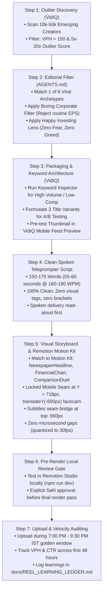

# Production Workflow: Integrating VidIQ with Editor of SaN
**Channel:** *Happy Investing*  
**Architecture:** VidIQ Outlier Discovery $\to$ 6 Archetypes Filter $\to$ Clean Teleprompter Script $\to$ Remotion Motion Kit $\to$ Publication & 48h Velocity Audit.

---

## 1. The End-to-End Production SOP

---

## 2. Detailed Stage Breakdown

### Stage 1: Weekly Outlier Discovery (Every Mon & Thu Morning)
1. Open the **VidIQ Web App > Competitors Tab**.
2. Select time filter: **"This Month"** or **"Past 14 Days"**.
3. Sort by **VPH (Views Per Hour)**.
4. Scan through our tracked **Emerging Niche Creators (10k–50k subs)**.
5. Identify any video showing a **$\ge 5\text{x}$ Outlier Score** with sustained velocity ($> 150\text{ VPH}$).

### Stage 2: Editorial & Corporate Filtering
Before committing production resources:
* **The 6 Archetypes Gate:** Does it belong to:
  1. *Consumer Platform Utility*
  2. *Shocking Drawdown Panic*
  3. *The Valuation Paradox*
  4. *Mega IPO & RHP Deconstruction*
  5. *Regulatory Threat / Rule Shock*
  6. *Smart Money / Institutional Trail*
* **The Boring Corporate Filter:** If it is a minor legal notice or routine single-digit earnings, **REJECT IMMEDIATELY**.
* **The Happy Investing Angle:** Ground the conclusion in financial discipline (e.g. balance sheet reality, audited cash flows, SaN's rule: *"No 200 DMA = No entry"*).

### Stage 3: Packaging & Pre-Flight Testing
* **Keyword Optimization:** Use VidIQ's Keyword Inspector to test 3 phrasing variations. Select the phrasing that hits the **High Volume / Low-to-Medium Competition** sweet spot.
* **Thumbnail Pre-Flight Simulation:**
  - Create the thumbnail using our high-contrast brand tokens (`#0D1117` charcoal dark canvas, `#F59E0B` gold accents, bold 3-word focal hook).
  - Open VidIQ’s **Thumbnail Preview Tool** and view at mobile scale (360px).
  - Verify that our thumbnail visually beats competing thumbnails in contrast and instant legibility.

### Stage 4: Scripting & Motion Graphics Integration
* Deliver a **100% clean spoken teleprompter script** (150–175 words, no brackets, no camera directions).
* Once SaN approves the script, build the motion graphics utilizing standardized components from `dmart-video-engine/src/motion-kit/` (NewspaperHeadline, MetricOdometer, StockTickerCard, ComparisonDuel, FinancialChart).
* Adhere strictly to the **Pre-Render Local Review Gate** (review locally in Remotion Studio before exporting full ProRes/heavy renders).

### Stage 5: Publishing & 48-Hour Velocity Auditing
* Publish during the **7:00 PM – 9:30 PM IST golden window**.
* Monitor VidIQ stats across the first 2–12 hours:
  - If **CTR is $< 4\%$**, immediately switch to Title Variant B.
  - If **VPH exceeds 300**, prepare a companion 9:16 Short or community poll to amplify momentum.
* Log all results in [`docs/REEL_LEARNING_LEDGER.md`](file:///D:/AI%20Projects/Editor_of_SaN/docs/REEL_LEARNING_LEDGER.md).
