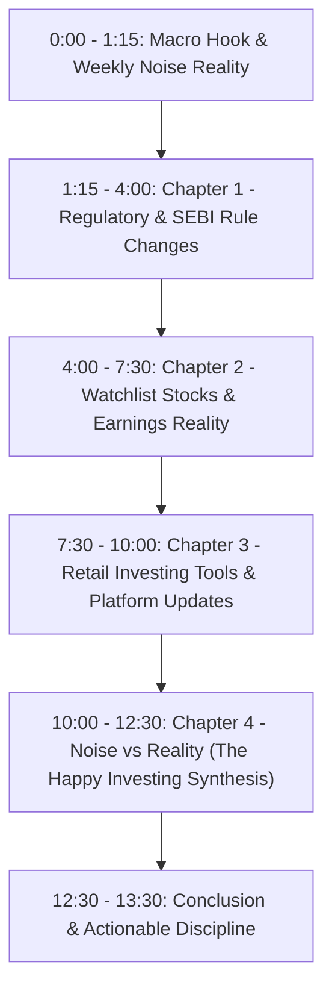

# Happy Investing: Weekend Long-Form YouTube Blueprint
**Week Code:** `2026-W42` | **Generated Date:** 2026-10-20  
**Format:** 10 to 14 Minutes Long-Form Video (16:9 1920x1080)  
**Channel Moat:** Zero Noise, Zero Fear, Zero Greed | Pure Ground Reality  

---

## 1. Title & High-CTR Thumbnail Strategy

### Proposed Titles:
1. **What Really Happened In The Markets This Week (Cut Through The Noise)**
2. **5 Key Market Truths Most Investors Missed This Week | Happy Investing**
3. **The Week in 12 Minutes: SEBI Changes, Big Earnings & What It Means For Your Money**

### Thumbnail Visual Concept:
- **Left Side:** High-contrast photo of SaN with a calm, analytical expression (no shocked open-mouth youtube faces).
- **Right Side:** Split card showing a noisy red headline with a bold diagonal stamp `"NOISE"`, contrasting with a clean green card stamped `"FACT"`.
- **Text Overlay (Max 4 words):** `"WHAT ACTUALLY HAPPENED"` (Clean bold Poppins font).

---

## 2. Core Themes Aggregated From This Week's Radar:
- Major SEBI circular updates
- Watchlist earnings updates
- Platform feature rollouts (e.g. Zerodha US Investing)

---

## 3. Full YouTube Video Chapter Breakdown (12 Minutes)

### Chapter 0: The Hook & Macro Truth (0:00 - 1:15)
- **Spoken Intent:** *"Every single day this week, headlines told you the market was either crashing or about to skyrocket. If you felt overwhelmed, that's by design. Today, we spend 12 minutes cutting through all the noise to look at the verifiable facts."*
- **Visual:** Rapid montage of the week's clickbait headlines slamming onto the screen, followed by a calm whiteboard wipe.

### Chapter 1: Regulatory Shifts & SEBI Truths (1:15 - 4:00)
- **Spoken Intent:** Break down any circulars or rules issued this week without sensationalism. Explain who it impacts (traders vs long-term investors).
- **Remotion Visual Asset:** Reuse `NewspaperHeadline.tsx` with animated yellow highlighter over official circular paragraphs.

### Chapter 2: Big Earnings & Valuation Reality (4:00 - 7:30)
- **Spoken Intent:** Review key watchlist movements (e.g., Avenue Supermarts / DMart, Reliance, Banks). Explain sales growth vs margin pressure, avoiding short-term quarterly overreactions.
- **Remotion Visual Asset:** Reuse `FinancialLineChart.tsx` and `StockTickerBadge.tsx` from this week's shorts.

### Chapter 3: Platform Features & Retail Investor Access (7:30 - 10:00)
- **Spoken Intent:** Cover major platform updates (like the Zerodha US stock investing feature from this week's 10k reel). Provide balanced pros and cons (LRS charges, currency risk, tax implications).
- **Remotion Visual Asset:** Reuse `UIRippleHighlight.tsx` and `ComparisonVersus.tsx`.

### Chapter 4: What Was Noise vs. What Actually Matters (10:00 - 12:30)
- **Spoken Intent:** The signature Happy Investing filter. Categorize the week's viral rumors into "Ignore Completely" vs "Keep On Your Radar".
- **Remotion Visual Asset:** 2-column checklist battle (`ComparisonVersus.tsx`).

### Chapter 5: Happy Investing Action Plan for Next Week (12:30 - 13:30)
- **Spoken Intent:** Direct, practical guidance: *"Don't trade the headlines. Keep your SIPs automated, focus on business balance sheets, and enjoy happy investing."*
- **Remotion Visual Asset:** `OutroVerifiedBadge.tsx` and channel subscribe motion card.

---

## 4. Production Synergy (How Daily Shorts Built This Video)
- **Research Time Saved:** ~4 hours (already researched and fact-checked during daily short generation).
- **Motion Graphics Reusability:** Remotion comps created for daily shorts can be imported directly into the long-form timeline in CapCut as B-Roll chapters.
